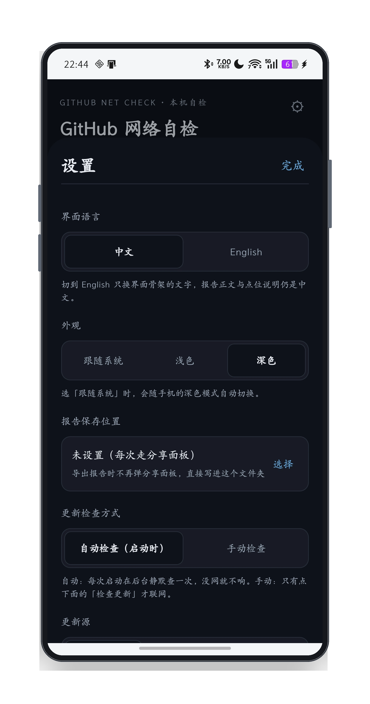
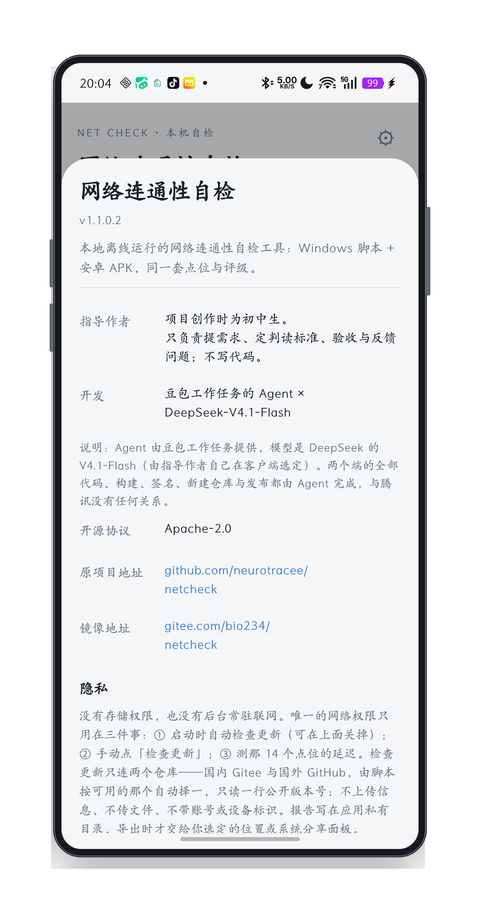
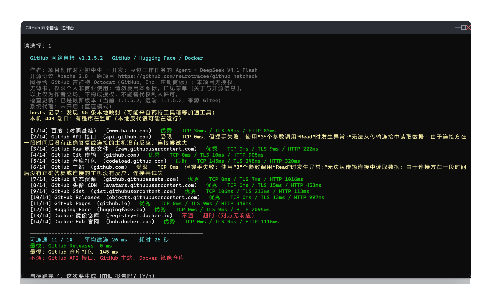

# GitHub 网络自检

[](https://github.com/neurotracee/github-netcheck/blob/main/LICENSE)
[](https://github.com/neurotracee/github-netcheck/releases/latest)
[](https://github.com/neurotracee/github-netcheck/releases)
[](https://gitee.com/bio234/github-netcheck)
[](https://github.com/neurotracee/github-netcheck/actions/workflows/ci.yml)

**中文** | [English](#netcheck--github-network-self-check)

> **本项目与 PDF 隐私打码工具同源同作者。** GitHub 仓库建得更早，Gitee 是同一名开发者维护的国内镜像
> （https://gitee.com/bio234/github-netcheck），两边内容一致，不存在谁抄谁。
>
> 作者的另一项目：**PDF 隐私打码工具**（本地离线给 PDF 打码，不上传文件）——
> GitHub https://github.com/neurotracee/pdf-privacy-masker ｜ Gitee https://gitee.com/bio234/pdf-privacy-masker 。
> 那个项目用 AGPL-3.0，本项目用 Apache-2.0，协议不同，别混用。

一个纯本地、零依赖的网络连通性自检工具，专门盯着**中国大陆能不能连上 GitHub 系服务**：**不代理、不加速、不改 hosts，只测量**。

> **创建时间**：本项目创建于 **2026 年 11 月 14 日**，同日完成 Windows 端脚本、安卓端 APK 与两平台仓库（GitHub `neurotracee/github-netcheck`、Gitee `bio234/github-netcheck`）。

> **关于名字**：本项目原名「网络连通性自检」，容易被理解成泛泛的测网速工具。它的实际用途是排查 GitHub（含 Pages、raw、
> API、对象存储、克隆下载）以及 Hugging Face、Docker 这些常被卡住的开发资源，所以从 1.1.0.3 起两端统一改名为 **GitHub 网络自检**；
> 仓库名也从 `netcheck` 改成了 **`github-netcheck`**（GitHub 与 Gitee 两边一起改，旧链接会跳转到新地址），
> 免得仓库名里只剩下一个宽泛的「网络检查」。包名 `com.neurotracee.netcheck` 与脚本名 `netcheck.ps1` 没动——
> 包名一改，手机上装过的旧版就没法覆盖升级了。

**关键词（给搜索用的标签）**：GitHub 连不上 排查 · GitHub 加速检测 · GitHub Pages 打不开 · raw.githubusercontent 加载失败 ·
网络连通性自检 · 连通性检测 · DNS 解析 / TCP 建连 / TLS 握手 / HTTP 首字节（四段分别计时）· 延迟测试 · hosts 映射检查 · 系统代理检查 ·
Hugging Face 下载慢 · Docker 拉取失败 · 国内网络环境 · Android APK · PowerShell 脚本 · Kotlin / Jetpack Compose · Apache-2.0 · 零第三方依赖

它把 14 个常被卡住的目标逐个测一遍，每个目标拆成 **DNS 解析 → TCP 建连 → TLS 握手 → HTTP 首字节** 四段分别计时，
出一份 HTML 报告，一眼能看出是「解析不出来」「连不上」「能连上但握手被掐」还是「链路能用但很慢」。

Windows 端是一段 PowerShell 脚本，双击就跑，不安装任何东西；安卓端是一个 APK，点一下就开始测。
**两端共用同一套测试点位、同一套评级阈值、同一套报告样式**，手机测完和电脑测完的两份报告可以直接对着看。

---

## 界面

<h3 align="center">两端界面</h3>

<p align="center">
  两端全部是真机截图，没有拼图、没有示意。图上看到的话术，就是程序里正在用的那一套。<br>
  安卓界面内置中英双语（「设置 → 界面语言」，默认跟随系统）；Windows 端目前是中文界面。下面是中文版，英文说明见本节末尾。
</p>

<h3 align="center">安卓：跑完一次，结论一眼看完</h3>
<p align="center">主界面 · 设置 · 关于。14 个点位逐条给出 DNS / TCP / TLS / HTTP 四段耗时，点一条展开细节。</p>

<p align="center">
  
  
  
</p>

<br>

<h3 align="center">Windows：控制台才是主程序</h3>
<p align="center">双击「一键网络自检.bat」出菜单：选 1 直接开测，14 个点位逐条给结果；选 3 弹关于窗、选 4 弹设置窗、选 5 只查更新。<br>
那两个窗口只是壳，主界面就是下面这张控制台 —— 真机跑出来的一次完整结果，长的那两行是连接失败时的原始异常信息。</p>

<p align="center">
  
</p>
<p align="center">
  <sub>↑ 控制台主界面（选 1，跑完全部 14 个点位）</sub><br>
  
  <br><sub>↑ 选 3 弹出的「关于与开源信息」窗，不是主界面</sub>
</p>

<br>

| 界面 | 说明 |
| --- | --- |
| 安卓 · 主界面 | 标题区 + 环境标签 + 两个按钮 + 四张汇总卡 + 逐条结果卡（点一条展开细节） |
| 安卓 · 设置页 | 界面语言 / 外观 / 报告保存位置 / 更新检查方式 / 更新源（自动默认 Gitee / 只用 Gitee / 只用 GitHub）/ 版本与检查更新 / 关于入口 |
| 安卓 · 关于页 | 指导作者、开发（豆包工作任务的 Agent × DeepSeek-V4.1-Flash）、协议、两个地址、隐私、三条硬要求、维护节奏 |
| Windows · 控制台（主程序） | 选项 1：14 个点位逐条给出 DNS / TCP / TLS / HTTP 四段耗时，末尾汇总「可连通 X/14、平均建连、耗时、最快 / 最慢 / 不通」 |
| Windows · 关于窗 | 选项 3 弹出：同一份「关于与开源信息」文案，外加赞赏码与两个仓库的 Star 直达按钮 |

> 手机三张图拍摄于 v1.1.0.x（11 月 14 日），界面结构一直没变；目标数量后来加到 14 个、版本号走到 1.1.5.x，以你现在装的那版为准。
> 关于窗那张是 v1.1.5.2 重拍的。
> 套壳脚本：手机 `docs/tools/frame_ui.py`（机身壳），Windows `docs/tools/frame_window.py`（窗口壳）；换新截图重跑一遍就行，不用手工修图。

<h3 align="center">In English</h3>

<p align="center">
  Everything above is a real-device screenshot — nothing is a mockup. The wording on screen is exactly the wording shipped in the app.<br>
  The Android UI ships with a built-in Chinese/English switch (<i>Settings → Language</i>, defaults to the system language); the Windows build is Chinese-only for now.
</p>

<p align="center">
  <b>Android</b> — one run, all verdicts at a glance. 14 endpoints, each reported with DNS / TCP / TLS / HTTP timings; tap a row for details.
</p>
<p align="center">
  
  
  
</p>

<p align="center">
  <b>Windows</b> — the console is the program; the windows are just shells. Run <code>一键网络自检.bat</code>,
  pick 1 to start the check (14 endpoints), 3 for About, 4 for Settings, 5 to check for updates.
</p>
<p align="center">
  
</p>
<p align="center">
  
</p>

---

## 下载（先点这里）

**当前版本：安卓 v1.1.5.3 ・ Windows v1.1.5.2**。两个平台内容一样，选能打开的就行（国内网络慢优先 Gitee）。

| 你要的 | GitHub | Gitee（国内镜像） |
| --- | --- | --- |
| 最新下载页 | https://github.com/neurotracee/github-netcheck/releases/latest | https://gitee.com/bio234/github-netcheck/releases/latest |
| 安卓 APK | https://github.com/neurotracee/github-netcheck/releases/download/v1.1.5.3/NetCheck-1.1.5.3.apk | https://gitee.com/bio234/github-netcheck/releases/download/v1.1.5.3/NetCheck-1.1.5.3.apk |
| Windows 包（zip） | https://github.com/neurotracee/github-netcheck/releases/download/v1.1.5.2/NetCheck-Windows.zip | https://gitee.com/bio234/github-netcheck/releases/download/v1.1.5.2/NetCheck-Windows.zip |
| 仓库首页 | https://github.com/neurotracee/github-netcheck | https://gitee.com/bio234/github-netcheck |

解压 Windows 包后双击 **一键网络自检.bat**；APK 直接安装（系统会提示「未知来源」，原因见下一节）。
校验值（SHA-256）写在 [Release 说明](https://github.com/neurotracee/github-netcheck/releases/latest) 里，下载后可用 `certutil -hashfile <文件名> SHA256` 自己核一遍。

> **Gitee 下载 APK 变成 .zip 后缀？不是文件坏了。** Gitee 的下载服务器按文件头识别类型，把 APK 判成了 `application/zip` 发给你，
> 部分手机浏览器（例如 Edge 手机版）就顺手把文件名改成 `.zip`。把后缀改回 `.apk` 就能照常安装，文件内容一模一样。
> 嫌麻烦就直接去 GitHub 下载页拿 APK（那边按 `application/vnd.android.package-archive` 发送，不会改后缀）。

### 旧版本附件放在哪里（Gitee 容量有限）

Gitee 的附件总容量只有 1GB，装不下所有历史包，所以安装包在两端的留存分三档，**Windows 与安卓同样对待**：

| 版本档位 | GitHub | Gitee（国内镜像） |
| --- | --- | --- |
| **最新版**（安卓 v1.1.5.3 的 APK、Windows v1.1.5.2 的 zip） | 保留附件 | **保留附件** |
| **上一版**（v1.1.5.1 的安卓 APK、v1.1.5.0 的 Windows zip） | 保留附件 | 保留附件（方便覆盖升级过渡） |
| **更早的旧版本** | 保留全部附件 | **附件已撤下**，只留发布说明 |

也就是说：**最新版和上一版的 Windows 包、安卓包在 Gitee 都能下**；只有更早的旧版本才需要到 GitHub 发布页找。
旧版本下载地址：https://github.com/neurotracee/github-netcheck/releases （Gitee 对应旧发布页里也会注明「旧版请到 GitHub 下载」并给出链接）。

**觉得有用就走，不用付钱。** 两个都点一下最实在：GitHub 那颗让国外和搜索引擎找到它，Gitee 那颗让不翻墙的人也打得开；只点一边，另一半人就搜不到——差一颗星，少一半人。不方便的话点一个就够。
[GitHub Star（标星）](https://github.com/neurotracee/github-netcheck) ｜ [Gitee Star（收藏）](https://gitee.com/bio234/github-netcheck)
要是这个小工具帮你省了点时间、愿意请我喝杯奶茶，文末「[赞赏](#赞赏)」一节有张微信赞赏码，**完全自愿，不打赏功能一个都不少**。

**版本说明**：这是四段版本号（主.次.修订.补丁），小修小改只加最后一段。所以 1.1.2.0 → 1.1.3.2 属于功能级更新（赞赏入口 + 启动查更新提示），
而 1.1.3.2 → 1.1.3.2 是**纯文案更新**：把「图标里含 GitHub 的 Octocat、本项目无授权无背书、仅限非商业使用、请勿复用图标」这段声明
写进了两端程序内部（关于页、控制台、报告页脚），功能一行没动。

## 装之前先看三件事

**① 为什么只在 Releases 下载，没上应用商店。**
作者是未成年人，华为 / 小米 / OPPO / vivo 四家应用市场的开发者上架要做互认证：手持身份证拍照 + 绑定**本人实名银行卡**。
作者拿不到本人实名银行卡（未成年人办不了），家里对「上传身份证 + 银行卡」这套流程也不理解、警惕被骗的心思很重，
所以这条路走不通，不是懒。因此 APK 直接放在 GitHub / Gitee 的 Releases 里，用作者自签证书签名，
系统会提示「未知来源」——**这是没走应用商店的必然结果，不是应用本身有问题**。

**② 安装时那句「信息可能会被第三方收集」是什么。**
那是安卓系统（尤其国产 ROM 的安装器）对**任何非应用商店来源的 APK** 统一弹的风险提示，说给所有人听，
不是针对本应用，也不代表本应用会收集什么。本应用申请的权限只有三项（`INTERNET`、`ACCESS_NETWORK_STATE`、
`REQUEST_INSTALL_PACKAGES`——最后一项只用于更新时把下好的安装包交给系统安装器，系统会再问一次是否安装），
没有存储、位置、通讯录、短信、相机权限，也没有任何统计 / 广告 / 崩溃上报 SDK（可对照
[AndroidManifest.xml](android/app/src/main/AndroidManifest.xml) 与 [NOTICE.md](NOTICE.md) 自行核对）。
签名证书指纹写在 Release 说明里，可以自己验。

**关于签名本身**（1.1.0.3 起）：APK 用 **APK Signature Scheme v2 + v3** 双重签名（v2 供 Android 7–8 校验，v3 供 9 及以上校验，
比只签 v2 更稳，部分国产 ROM 的安装器会严格检查 v3）。证书是自签的，DN 为
`CN=NetCheck, OU=OpenSource, O=neurotracee, L=Datong, ST=Shanxi, C=CN`，
SHA-256 指纹 `c43205775efaf5d088b646d6999e81e08213c43969b3140b541c29d0c7bb8b5a`——自行核对命令：

```text
apksigner verify -v --print-certs NetCheck-<版本号>.apk
```

自签证书的含义只是「没有商业 CA 背书」，不等于不安全；**它不是应用商店的护照，也不影响覆盖升级**。
从 1.0.0.0 到 1.1.0.3 一直是同一把密钥，所以旧版可以直接覆盖安装，不用卸载。

**③ 它到底连了什么网。**
联网权限只有一项 `INTERNET`，只用在三件事：**启动时自动检查更新（可在设置里关掉）**、
**手动点「检查更新」**、**测那 14 个点位的延迟**。
检查更新只连**两个仓库**——国内 Gitee（https://gitee.com/bio234/github-netcheck）、国外 GitHub
（https://github.com/neurotracee/github-netcheck），由脚本按可用的那个自动择一，读一行公开的版本号。
**不上传任何信息、不传文件、不带账号、不带设备标识**；测延迟时也只发连接和一次响应头读取，不提交内容。


---

## 这个项目是谁做的

- **指导作者：项目创作时为初中生。** 只负责三件事：提出需求、确定测试点位的取舍与判读标准、验收并反馈问题。他不写代码。
- **开发：豆包工作任务的 Agent × DeepSeek-V4.1-Flash。** 全部施工——两个端的代码、构建、签名、新建仓库与发布——都由 Agent 在他反复提需求与反馈下完成。
- **名词说明（别混淆）**：**Agent 由豆包工作任务提供**，**模型是 DeepSeek 的（V4.1-Flash，由指导作者自己在客户端选定）**。所以这不是「豆包的模型」，也不是腾讯的产品，跟腾讯没有任何关系。
- **开源协议：Apache License 2.0。** 详见 [LICENSE](LICENSE)，署名与出处要求见 [ADDITIONAL-TERMS.md](ADDITIONAL-TERMS.md) 与 [NOTICE.md](NOTICE.md)。
- **维护方式**：个人业余时间维护，代码全部公开，欢迎任何人 fork 自行改进，不必询问。具体节奏与反馈渠道见文末「[维护节奏与反馈](#维护节奏与反馈)」。

## 关于署名（二次开发或商用前请先看这一段）

本项目**允许商用，也允许二次开发、允许闭源分发**（Apache-2.0 不是 copyleft，没有强制开源的传染性），
不需要付钱、不需要申请、不需要等作者批准（作者大约一两个月查看一次项目，回复可能很慢）。

但下面**三条是硬要求**，依据是 Apache-2.0 第 4 条 (b)(c)(d) 项与第 6 条（商标），详见 [ADDITIONAL-TERMS.md](ADDITIONAL-TERMS.md)：

### ① 保留作者署名

继续注明这两句，原文保留，不要替换成别人的名字：

```
指导作者：项目创作时为初中生
由 豆包工作任务的 Agent × DeepSeek-V4.1-Flash 开发
```

依据 Apache-2.0 第 4 条 (c) 项：必须保留源码中的版权、专利、商标与署名声明。

### ② 在程序里标注原项目地址

```
https://github.com/neurotracee/github-netcheck
https://gitee.com/bio234/github-netcheck      # mirror / 镜像（国内访问更快）
```

**必须让使用者看得见**——「关于」窗口、首页页脚、帮助菜单、报告页脚、`--about` 输出，任选一处即可。
只写在 `LICENSE` 文件或几百行开外的源码注释里**不算数**，因为使用者正常操作时看不到。

本项目的做法（可以直接照搬）：

| 位置 | 内容 |
| --- | --- |
| 安卓端首页页脚 | `原项目地址：https://github.com/neurotracee/github-netcheck` + `镜像（Gitee）：gitee.com/bio234/github-netcheck`（两行可点，点了复制） |
| 生成的 HTML 报告 | 报告页脚同样两行地址 |
| Windows 端 | 控制台首行与说明文档首屏 |

### ③ 改过的版本必须说明改过

只要你不是拿原版原样分发，就在程序里显著注明：

> 本程序基于 https://github.com/neurotracee/github-netcheck
> （镜像：https://gitee.com/bio234/github-netcheck）修改，非原作者发布。

依据 Apache-2.0 第 4 条 (b) 项：修改过的文件必须带上「已修改」的显著说明。

这一条是为了不让人误以为改动后的版本出自原作者——尤其是你的版本有 bug、有隐私风险、或者开始收费的时候。

### 除此之外，Apache-2.0 本身还要求

- **随分发附带协议与 NOTICE**：分发 APK 或脚本时，把 `LICENSE` 与 `NOTICE.md` 一并给出（第 4 条 (a)(d)）。
- **保留修改标记**：改过的源文件要写明改了什么（第 4 条 (b)）。
- **不要用作者的名义做背书**：不能暗示原作者为你的版本担保（第 6 条）。
- **换个名字**：程序名「GitHub 网络自检 / NetCheck」与图标不在授权范围内（第 6 条商标条款），
  fork 请改名换图标，避免别人误认。

需要闭源商用？**Apache-2.0 允许**，但上面三条署名与出处要求仍然有效。

### ④ 图标（重要，这一段优先于上面任何与图标相关的表述）

**图标里有一只 GitHub 的猫。** 本项目的图标（`assets/icon/` 下的 png 与 ico，以及 Windows 端和安卓端的应用图标）中，
猫头剪影来自 GitHub 的吉祥物 **Octocat**。**Octocat® 是 GitHub, Inc. 的注册商标**（GitHub, Inc. 现为 Microsoft 旗下公司），
该形象另在美国版权局做过作品登记。这些权利**不属于本项目作者**，本项目**未获得 GitHub, Inc. 或 Microsoft 的任何授权、认可或背书**。

项目名里的「GitHub」只用于说明本工具**检查的对象**（与 GitHub 各服务的连通性），属于指示性使用，不代表与 GitHub 官方有任何关联。

| 边界 | 说明 |
| --- | --- |
| **本项目自身的定位** | **仅限个人、非商业使用**。作者不售卖、不上架应用商店、不接受商业授权，也不从本项目取得任何收入（赞赏仅为读者自愿的小额支持，与授权无关）。**禁止将本项目用于任何商业用途。** |
| **强烈建议不要使用这个图标** | fork、二次开发、改名发布，或打算用于任何其他项目，**请自行替换成不含任何第三方商标元素的图标**。不要直接沿用，也不要改动后继续使用。只在自己机器上用不受此限。 |
| **权利人可要求移除** | 若 GitHub, Inc. 或 Microsoft 认为本图标使用不妥，向仓库 Issue 提出后，本项目会立即更换图标并清理相关说明。 |
| **声明不是护身符** | 以上文字只用来表明作者立场与使用边界，**不构成授权，不能替代权利人的许可，也不能免除使用者自身的法律责任**。需要商用或大范围公开传播，请先取得权利人书面许可。 |

---

## 测的是什么

每个目标按顺序测四段，分别计时，能精确定位卡在哪一步：

| 阶段 | 含义 | 失败说明 |
|---|---|---|
| DNS | 域名解析耗时 | 解析不出来 = DNS 污染或断网 |
| TCP | 到 443 端口的建连耗时 | 超时 = 端口不通，多半被阻断 |
| TLS | 加密握手耗时 | 超时 / 被重置 = SNI 干扰，典型表现就是「网站打不开但 ping 通」 |
| HTTP | 发出请求到收到首字节（TTFB） | 超时 = 链路被掐断 |

### 14 个测试点位

| 分组 | 点位 | 用途 |
|---|---|---|
| 基准 | 百度 `www.baidu.com` | 先确认本地宽带本身正常 |
| GitHub | API 接口 `api.github.com/rate_limit` | Agent 查仓库、拉元数据，顺带读出当前配额 |
| GitHub | Raw 原始文件 `raw.githubusercontent.com` | Agent 直接读取仓库里的文件内容 |
| GitHub | Git 传输 `github.com/.../info/refs` | git clone / pull 真正走的通道 |
| GitHub | 仓库打包 `codeload.github.com` | 下载仓库 zip / tar |
| GitHub | 主站 `github.com` | 网页 / 仓库首页 |
| GitHub | 静态资源 `github.githubassets.com` | 图标 / 页面资源 |
| GitHub | 头像 CDN `avatars.githubusercontent.com` | 头像 / 图片 |
| GitHub | Gist `gist.githubusercontent.com` | 代码片段、配置 |
| GitHub | Releases `objects.githubusercontent.com` | 发行包下载 |
| GitHub | Pages `github.io` | Pages 站点 |
| AI | Hugging Face `huggingface.co` | 模型 / 数据集 |
| 容器 | Docker 仓库 `registry-1.docker.io/v2/` | docker pull |
| 容器 | Docker Hub `hub.docker.com` | 镜像页 / 登录 |

报告顶部会显示 **API 配额**（未登录时是 60 次/小时），Agent 频繁调接口被限流时看这个数字。
「只测 GitHub 系」会跳过 Hugging Face 与 Docker 两项，测 11 个点位，快 3～8 秒。

## 判读

| 标签 | 依据 | 说明 |
|---|---|---|
| 优秀 | 建连 ≤ 120 ms | 和国内站点差不多快 |
| 良好 | ≤ 400 ms | 正常可用 |
| 一般 | ≤ 1000 ms | 能用但会卡顿 |
| 较慢 | > 1000 ms | 几乎没法用 |
| 受限 | TCP 通、TLS 失败 | 最典型的「被墙」状态 |
| 不通 | TCP 都连不上 | 完全阻断 |

报告里的 **DoH 真实解析**：用阿里公共 DNS 加密查询拿到该域名的真实 IP，和本机解析结果对比。
两者不一致，说明本机 DNS 被改写或被污染；如果本机 IP 显示 `127.0.0.1`，说明域名被 hosts 接管了。

## 处理效果

一次真实运行的产物长这样（2026-11-14 家庭宽带实测，完整 14 点位模式）：顶部是环境标签（系统代理、hosts 映射、
本机 443 监听、DNS 服务器），中间四张汇总卡，下面每个点位一张卡——左侧竖条是评级颜色，右边是 DNS / TCP / TLS / HTTP
四段各自的毫秒数，域名下面一行是解析到的 IP 与 DoH 对照结论。


同一个数据还会在控制台打一份纯文本，跑完直接把报告甩进浏览器：

```text
  网络连通性自检 v1.1.0.1   GitHub / Hugging Face / Docker
  （下面这段是 1.1.0.1 时的真实输出，当时还叫「网络连通性自检」；1.1.0.3 起同名位置显示为「GitHub 网络自检」）
  ---------------------------------------------------------
  作者：项目创作时为初中生 · 开发：豆包工作任务的 Agent × DeepSeek-V4.1-Flash
  开源协议 Apache-2.0 · 原项目 https://github.com/neurotracee/github-netcheck
  系统代理：未开启（直连模式）
  hosts 记录：发现 45 条本地映射（可能来自瓦特工具箱等加速工具）
  本机 443 端口：有程序在监听（本地反代很可能在运行）

  [1/11] 百度（对照基准）  (www.baidu.com)   优秀   TCP 32ms / TLS 64ms / HTTP 150ms
  [2/11] GitHub API 接口  (api.github.com)   优秀   TCP 0ms / TLS 10ms / HTTP 1297ms
  [3/11] GitHub Raw 原始文件  (raw.githubusercontent.com)   优秀   TCP 0ms / TLS 12ms / HTTP 525ms
  [4/11] GitHub Git 传输  (github.com)   优秀   TCP 0ms / TLS 9ms / HTTP 810ms
  [5/11] GitHub 仓库打包  (codeload.github.com)   受限   TCP 103ms，但握手失败：读取响应超时（链路被掐断）
  [6/11] GitHub 主站  (github.com)   优秀   TCP 0ms / TLS 1ms / HTTP 786ms
  [7/11] GitHub 静态资源  (github.githubassets.com)   优秀   TCP 0ms / TLS 7ms / HTTP 1028ms
  [8/11] GitHub 头像 CDN  (avatars.githubusercontent.com)   优秀   TCP 0ms / TLS 9ms / HTTP 471ms
  [9/11] GitHub Gist  (gist.githubusercontent.com)   较慢   TCP 1141ms / TLS 280ms / HTTP 141ms
  [10/11] GitHub Releases  (objects.githubusercontent.com)   优秀   TCP 0ms / TLS 10ms / HTTP 550ms
  [11/11] GitHub Pages  (github.io)   优秀   TCP 0ms / TLS 9ms / HTTP 309ms

  ---------------------------------------------------------
  可连通 10 / 11    平均建连 117 ms    耗时 21 秒
  API 配额 56 / 60
  最快：GitHub 静态资源  0 ms
  最慢：GitHub Gist  1141 ms
  不通：GitHub 仓库打包

  报告已生成：reports\netcheck-20261114-193319.html
```

那个「TCP 0ms」不是作弊：本机反代把连接在本地就接住了，所以建连几乎不耗时——恰恰说明流量没真正走远。
`codeload` 那条「能连上但握手失败」才是这类工具最该报出来的状态：TCP 通了，TLS 被掐，下载仓库 zip 就会失败。

## 和瓦特工具箱是什么关系

瓦特工具箱（Watt Toolkit，原名 Steam++）的加速思路是：

```
hosts 把域名指向 127.0.0.1
      ↓
本机跑一个 YARP 反向代理（监听 80/443）
      ↓
反代用自己的线路去连真实服务器
      ↓
浏览器以为在直连，实际走的是本机反代（中间人，靠自签根证书解密）
```

这个工具的定位不一样：**它不代理，只测量**。
所以最实用的用法是——加速器关着跑一次，开着再跑一次，两份报告对比，立刻就能看出加速到底有没有生效、哪个域名还在掉。

需要注意两种模式的差异：

- **hosts 模式**：域名解析到 127.0.0.1，报告里的 IP 会显示 127.0.0.1，测到的延迟其实是「你到本地反代」的延迟，不代表到真实服务器的速度
- **系统代理模式**：本工具用原生 socket 直连，不走系统代理，所以测到的仍是真实直连状况——正好可以用来判断「如果不加速会有多惨」
- **安卓端的 VPN 模式**（Clash 类工具）：VPN 在系统层接管流量，socket 无法绕过，这时测到的就是「走规则后的结果」。报告顶部会标「VPN 已启用」，看数值时请把这层算进去

## 版本号与更新检查（只发一端时，另一端不会被误报）

版本号是四段 `主.次.修订.补丁`，例如 `1.1.3.2`：

- 只改文案、修小 bug → 只动**第四段**（`1.1.0.3` → `1.1.0.4`）；
- 加了新功能 → 动**第三段**（`1.1.1.x` → `1.1.3.2`）；
- 前两段基本不动，动了就是大版本，别轻易用。

仓库根目录有一份 `version.json`，**按平台分开写版本号**：

```json
{
  "android": { "version": "1.1.3.2", "url": "https://github.com/neurotracee/github-netcheck/releases" },
  "windows": { "version": "1.1.3.2", "url": "https://github.com/neurotracee/github-netcheck/releases" }
}
```

两端的「检查更新」都先读这个文件，**只认自己那一段**：只发 Windows 更新、把 `windows.version` 改成 `1.1.0.4`，
安卓端读到的仍是 `1.1.3.2`，就不会莫名弹出「有新版本」；反过来也一样。
这修掉了以前「发一次 Release，两端都提示更新但只有一端真变了」的逻辑 bug。
读不到 `version.json` 时才会退回读 Release（发布版本）的 tag，所以老环境也不会瞎。

**更新源默认 Gitee**：两端都只在「界面语言不是中文」且「系统时区不是 UTC+8」同时成立时（明确迹象说明大概率不在中国大陆），
才默认改走 GitHub；任何一条判断不出来（中文界面 / 时区 +8 / 读不到）一律走 Gitee。
用户可在设置里手动锁定「只用 Gitee」或「只用 GitHub」；选中的源连不上会自动换另一个再试一次。

**检查更新的规矩（两端一致）**：

- **什么时候查**：只在启动时查一次，没有定时轮询，也没有后台常驻进程；关掉「自动检查更新」就完全不联网。
- **查什么**：只 GET 两份公开内容——`version.json`（版本号），以及**仅在真有新版本时才多读一次**的发布列表（用来显示更新说明）。
  UA 里只带自己的版本号，不上传任何本地内容。
- **怎么算「有新版本」**：版本号统一按四段补零比较（`1.1.3` 与 `1.1.3.0` 视为同一版）；只认自己平台那一段，
  **某一版只给另一端发过包时，对本平台等于没有更新**——这就是不会误报的根本原因。
- **弹窗里能直接读到这一版改了什么**：不再是干巴巴一句「发现新版本」，而是把发布页正文里的摘要和
  按 Windows / 安卓 分条的条目直接显示出来，说明太长方框内可上下滚动。
  **落后好几个版本时**（例如停在 1.1.2.0，仓库已有 1.1.4.0、1.1.5.0）：变成一页一版的说明浏览器，
  最多列最近 4 版，左右翻看更早 / 更新的说明；**但下载目标永远是那一版最新的**，
  绿框里也写明了「翻页只换说明，不改变要装的版本」。
- **发现之后**：弹一次提示，默认在**应用内直接下载并安装**（下完核对包名与版本号，再交给系统安装器，不经过浏览器）；
  另留「用浏览器下载 / 复制链接」作为退路。点「以后再说」下次启动还会再提醒
  （故意不做「跳过此版本」的永久记忆，否则容易再也想不起来更新）。
- **下载地址只认自家域名**：`github.com`、`objects.githubusercontent.com`、`release-assets.githubusercontent.com`、
  `codeload.github.com`、`gitee.com`，而且必须是 https；不在这份名单里就只给发布页，不给直链。
- **不更新照样能用**：代码里没有任何「不更新就不给用」的逻辑；覆盖安装即可，设置与历史报告都保留。

## 怎么用

### 方式一：Windows，双击就跑

1. 到 **[Releases 页面](https://github.com/neurotracee/github-netcheck/releases/latest)** 下载 `NetCheck-Windows.zip`（或直接下载仓库里 `windows/` 目录的两个文件；国内网络慢可以去 [Gitee 发布页](https://gitee.com/bio234/github-netcheck/releases/latest)，两边是同一个包）。
2. 解压，双击 **一键网络自检.bat**，会出现一个菜单：

   ```
   [1] 开始自检（14 个点位，约 30 秒）
   [2] 只测 GitHub 系（更快）
   [3] 关于与开源信息
   [4] 设置（报告位置 / 先问我 / 自动打开 / 自动查更新 / 超时）
   [5] 检查更新（只读远端版本号）
   [0] 退出
   ```

   菜单顶部常驻署名、协议与两个项目地址——这个工具是谁做的、从哪儿来的，直接摆在最显眼的地方。
3. 选 1（或 2），逐个测试 14 个目标，大约 15～40 秒（看网络差到什么程度）。
4. 测完**不会闷头生成一堆文件**，而是先问三句：
   - 「这次要生成 HTML 报告吗？」（回车 = 是）
   - 「要现在用浏览器打开吗？」（回车 = 是）
   - 「记住这次的选择吗（下次不再问）？」（默认不记）

   答「记住」就把这次的选择写进 `settings.json`，之后不再打扰；想改回来，进「设置」勾上「每次自检结束后先问我」即可。
   报告存到 `reports\`（`latest.html` 是最新一份，历史按时间戳各存一份 HTML + CSV）。

不需要安装 PowerShell 模块、不需要 Python、不需要联网安装任何东西——用的是 Windows 自带的 PowerShell 5.1。
如果系统提示「无法加载文件，因为在此系统上禁止运行脚本」，用 bat 启动即可（bat 里已经带了 `-ExecutionPolicy Bypass`）。

### 方式二：安卓，装 APK

1. 到 **[Releases 页面](https://github.com/neurotracee/github-netcheck/releases/latest)** 下载 `NetCheck-<版本号>.apk`（Android 8.0 及以上，通用包，不挑 CPU 架构）。
2. 点开安装；系统提示「未知来源」时，允许当前文件管理器安装即可。
3. 打开应用，点 **开始自检**。测的过程中能看到「正在测试 3 / 14 · GitHub API 接口」。
4. 测完：每行可点开看细节（状态码、DoH 对照、四段耗时）；点 **导出报告** 把 HTML 交给你（见下面的保存位置说明），点 **分享 CSV** 导出原始数据。
5. 右上角 **齿轮** 进设置：界面语言（中文 / English）、外观（跟随系统 / 浅色 / 深色）、
   报告保存位置、更新检查方式、更新源（自动默认 Gitee / 只用 Gitee / 只用 GitHub）、版本与更新；最下面是 **关于与开源信息**
   （署名、协议、两个地址、隐私说明、二次开发三条硬要求）。

**报告保存位置**：默认走系统分享面板（发微信、发邮件、存到「文件」都行）；在设置里选了一个文件夹之后，
导出就直接写进那个文件夹，不再弹分享面板。

权限三个，都只服务于测量与更新本身：`INTERNET`（发起 socket 连接）、`ACCESS_NETWORK_STATE`（读当前网络类型、代理、私有 DNS、DNS 服务器）、
`REQUEST_INSTALL_PACKAGES`（更新时把下好的 APK 交给系统安装器，系统会再确认一次）。
没有存储权限——报告写在应用私有目录，导出时由你指定落地位置（SAF 授权，只给那一个目录）。
不做任何统计埋点，不上传任何数据；联网只有两处：自检本身，以及更新检查（只读一个公开版本号，
默认启动时静默查一次，可在设置里改成纯手动）。

### 方式三：从源码跑 Windows 端

```powershell
powershell -ExecutionPolicy Bypass -File .\windows\netcheck.ps1
```

进阶用法：

```powershell
# 只测 GitHub 系（快一些）
powershell -ExecutionPolicy Bypass -File .\windows\netcheck.ps1 -Quick

# 测完不询问、不打开浏览器，只按记住的「要不要报告」执行（给自动化/CI 用）
powershell -ExecutionPolicy Bypass -File .\windows\netcheck.ps1 -NoBrowser

# 只弹「关于与开源信息」窗口
powershell -ExecutionPolicy Bypass -File .\windows\netcheck.ps1 -About

# 只弹设置窗口（报告存哪、要不要先问我、自动打开、自动查更新、单段超时）
powershell -ExecutionPolicy Bypass -File .\windows\netcheck.ps1 -Settings

# 只查一次最新版本号，不测网络
powershell -ExecutionPolicy Bypass -File .\windows\netcheck.ps1 -CheckUpdate
```

设置写在脚本同目录的 `settings.json`（不写注册表、不联网），删掉它就恢复默认：

```json
{
  "ReportDir": "reports",
  "AutoOpen": false,
  "TimeoutMs": 3000,
  "AutoCheckUpdate": true,
  "AskBeforeReport": true,
  "SaveReport": true
}
```

`AskBeforeReport` 是「每次自检结束后先问我」；`AutoOpen` / `SaveReport` 只在关掉询问时生效；
`AutoCheckUpdate` 是启动时静默查一次版本号（只读公开文件，连不上就跳过）。

想换测试目标，用记事本打开 `windows/netcheck.ps1`，改开头 `$Targets` 那段，照着格式加一行就行：

```powershell
@{ Name = '某个站点'; Host = 'example.com'; Path = '/'; Desc = '备注' }
```

安卓端要改点位，改 `android/app/src/main/java/com/neurotracee/netcheck/net/Targets.kt` 的 `all` 列表，字段一一对应。

## 自己打包

Windows 端不需要打包：`.ps1` 是纯文本脚本，`bat` 只是个启动器。

安卓 APK：JDK 17 + Android SDK 34 + Gradle 8.7。

```bash
cd android
gradle assembleRelease
```

产物在 `android/app/build/outputs/apk/release/app-release.apk`。
签名配置读 `android/keystore.properties`（不入仓库），没有这个文件时会打出未签名的 release 包。
完整步骤、签名怎么生成、产物怎么核对，见 [docs/05-构建与发布.md](docs/05-构建与发布.md)。

## 已知限制

- **测的是 TCP/TLS 握手延迟，不等于下载速度。** 要测带宽得另外传大文件，本工具不做。
- **只测 IPv4、TLS 1.2。** 两端一致：安卓端强制 `TLSv1.2`，与桌面端 `SslProtocols::Tls12` 对齐，保证两台设备上的数值可比。
  代价是某些只支持 TLS 1.3 的站点会被判「受限」，目前 14 个点位里没有这种站点。
- **为了测纯网络连通性，证书校验被忽略。** 所以「证书链有问题但能连上」的情况，报告会显示正常。
- **超时统一 3 秒。** 网络特别差的时候，某些目标可能本来 5 秒能连上也被判失败——重跑一次看是否稳定即可。
- **安卓端拿不到的三项信息，用等价项替代**（这是两端报告唯一的结构性差异）：
  - 「本机 443 端口是否有程序在监听」→ 安卓不允许普通应用枚举端口，改为显示 **VPN 是否启用** 与 **私有 DNS 模式**；
  - 「系统代理」→ 安卓读的是 `ConnectivityManager` 的默认代理，不是 IE 那种注册表设置；
  - 「hosts 映射」→ 读 `/system/etc/hosts`，安卓上这个文件通常为空，读到几条就显示几条。
- **安卓 7 及以下不支持**（`minSdk 26`）。要用更低版本得自己改 `app/build.gradle.kts` 并处理 `privateDns` 相关的 API 差异。
- **每次运行都会在报告目录留一份 HTML 和 CSV**，觉得多了可以自己删（Windows 在 `reports/`，安卓在应用私有目录，卸载即清空）。

## 依赖与许可

| 依赖 | 版本 | 用途 | 许可 |
| --- | --- | --- | --- |
| Windows PowerShell（.NET Framework） | 系统自带 5.1+ | 脚本运行时 | 随 Windows 分发 |
| [AndroidX](https://developer.android.com/jetpack/androidx)（core-ktx / lifecycle / activity-compose） | 1.13.1 / 2.8.4 / 1.9.1 | 安卓基础框架 | Apache-2.0 |
| [Jetpack Compose](https://developer.android.com/jetpack/compose)（ui / foundation / material3 / material-icons-core） | BOM 2024.06.00 | 界面 | Apache-2.0 |
| [Kotlin 标准库](https://kotlinlang.org/) | 1.9.24 | 语言运行时 | Apache-2.0 |
| Android Gradle Plugin / Gradle | 8.4.2 / 8.7 | 构建（不进入产物） | Apache-2.0 |
| JUnit 4 / kotlin-test | 4.13.2 / 1.9.24 | 单元测试（不进入产物） | EPL-1.0 / Apache-2.0 |

**没有任何需要单独声明的第三方隐私/网络库**：探测内核是原生 `java.net.Socket` + `javax.net.ssl`，
界面是 Compose，HTTP 请求是手写的（就为了能分段计时）。所以 APK 里没有 OkHttp、没有统计 SDK、没有广告 SDK。
完整声明见 [NOTICE.md](NOTICE.md)。

## 隐私说明

- **不代理、不改系统设置、不写 hosts。** 全程只发起连接、只读响应头。
- **不联网上报任何东西。** 对外只发起这些连接：14 个测试点位本身、一次 DoH 对照查询（发往阿里公共 DNS）、
  以及安卓端启动时的一次更新检查（只读 Gitee 或 GitHub 上一个公开的版本号，不传本机任何信息，可在设置里关掉）。
- **报告不出本机。** Windows 端写在 `reports/`（或你在设置里指定的目录）；安卓端写在应用私有目录，只有你主动点「导出」才会离开应用。
- **报告里只包含**：点位名、域名、解析到的 IP、四段耗时、HTTP 状态码、评级。不含设备标识、不含账号、不含浏览记录。
- **安卓端不读通讯录、不读短信、不读相册、不要存储权限。**
- **Windows 端不用管理员权限、不写注册表**，设置只存在脚本同目录的 `settings.json`。
- 生成的 HTML 报告是**静态文件**，没有任何外链脚本或图片，断网也能打开。

## 许可

Apache License 2.0，见 [LICENSE](LICENSE)。
署名与出处要求（第 4 条与第 6 条的落地写法）见 [ADDITIONAL-TERMS.md](ADDITIONAL-TERMS.md)，第三方组件声明见 [NOTICE.md](NOTICE.md)。

```
Copyright (C) 2026 项目创作时为初中生

Licensed under the Apache License, Version 2.0 (the "License");
you may not use this file except in compliance with the License.
You may obtain a copy of the License at

    http://www.apache.org/licenses/LICENSE-2.0

Unless required by applicable law or agreed to in writing, software
distributed under the License is distributed on an "AS IS" BASIS,
WITHOUT WARRANTIES OR CONDITIONS OF ANY KIND, either express or implied.
See the License for the specific language governing permissions and
limitations under the License.
```

## 文档

| 想看什么 | 去哪 |
| --- | --- |
| 这一版更新了什么、修了什么 | [CHANGELOG.md](CHANGELOG.md) |
| 文档地图：哪个文件在哪、怎么找 | [DOCS.md](DOCS.md) |
| Windows / 安卓 完整操作说明 | [docs/01](docs/01-使用说明-Windows.md) · [docs/02](docs/02-使用说明-安卓.md) |
| 检测方法与判读标准 | [docs/03](docs/03-检测方法与判读标准.md) |
| 常见问题 | [docs/04](docs/04-常见问题.md) |
| 打包、测试、发版 | [docs/05](docs/05-构建与发布.md) |
| 怎么发 Release（网页一步步点） | [docs/06](docs/06-发布Release操作指南.md) |
| 想参与改进、提缺陷、加点位 | [CONTRIBUTING.md](CONTRIBUTING.md) |

安卓端没有单独的 README：两端的能力、许可、署名共用一套说法，写两份必然一头改了一头忘。

## 维护节奏与反馈

这个项目由个人在业余时间维护，取舍很直白：**测不准、判读误导、结果不稳定**这类问题优先处理；界面润色、锦上添花的功能可以慢慢来。代码全部公开，任何人不经询问就可以 fork 自行改进，不必等作者回复。

- **报缺陷**：到 [Issues](https://github.com/neurotracee/github-netcheck/issues/new/choose) 按模板填，写清版本号、系统/机型、哪几个点位、报告截图。两端 Issues 都开着，Gitee 那边也行（[Gitee Issues](https://gitee.com/bio234/github-netcheck/issues)）。
- **提改进 / 提代码**：先看 [CONTRIBUTING.md](CONTRIBUTING.md)，里面有目录结构、怎么跑自检、以及提交时会被要求做什么。
- **回复可能不快**：看到了会处理，没回不代表没看见，也不代表被否掉。

## 赞赏

如果这个项目帮你省了时间，可以请我喝杯奶茶 🧋


> **这张图在 GitHub 页面上显示不出来？** 不是你操作错了，也不是图片删了。README 里的仓库内图片在 GitHub 页面上走
> `raw.githubusercontent.com`，这个域名在国内常被掐断——本工具测的正是这个点位。到 Gitee 仓库的同一页看就有图：
> https://gitee.com/bio234/github-netcheck （文末「赞赏」一节）。两端程序里的二维码是**内置图片**，不依赖网络，
> 断网也能看：Windows 端「关于与开源信息」窗口、安卓端「关于」页最下面的「赞赏（完全自愿）」卡片。

程序里也能直接看到这张码：Windows 端「关于与开源信息」窗口、安卓端「关于」页的「赞赏（完全自愿）」卡片，
文案是同一句——**要是这个小工具帮你省了点时间，愿意的话可以请我喝杯奶茶；不打赏也一模一样用，功能一个都不少。**

> **点 Star 比打赏更有用。** 两个都点一下最实在：GitHub 那颗让国外和搜索引擎找到它，Gitee 那颗让不翻墙的人也打得开；
> 只点一边，另一半人就搜不到——差一颗星，少一半人。不方便的话点一个就够，功能一个不少。
> 直达：[GitHub Star（标星）](https://github.com/neurotracee/github-netcheck) ｜ [Gitee Star（收藏）](https://gitee.com/bio234/github-netcheck)
>
> 国内用户也可以扫码请我喝杯奶茶——完全自愿，不打赏一样免费、功能不缺。

---

---

# NetCheck — GitHub Network Self-Check

[中文](#github-网络自检) | **English**

> **This project has the same author as PDF Privacy Masker.** The GitHub repository was created first;
> Gitee (https://gitee.com/bio234/github-netcheck) is the developer's own mirror for faster access in mainland China.

A local-only, dependency-free connectivity probe. **It does not proxy, does not accelerate, does not touch hosts — it only measures.**

It times 14 targets that commonly break, splitting each one into **DNS → TCP connect → TLS handshake → HTTP time-to-first-byte**, four separately measured stages, then writes an HTML report. One glance tells you whether the problem is resolution, connection, handshake interference, or a slow-but-working link.

The Windows build is a single PowerShell script you double-click; the Android build is an APK.
Both share the **same target list, same grading thresholds, same report layout**, so a phone report and a desktop report can be compared side by side.

**License:** Apache License 2.0 — commercial use, modification and closed-source redistribution are all permitted.
Attribution and project-URL requirements are described in [ADDITIONAL-TERMS.md](ADDITIONAL-TERMS.md) (Apache-2.0 §4 and §6) and are part of the terms.

> **Icon and trademark notice (this section prevails over anything above that mentions the icon).**
> The project icon (the PNG/ICO files under `assets/icon/` and the app icons used by the Windows and Android builds)
> contains a silhouette of **Octocat**, GitHub's mascot. **Octocat® is a registered trademark of GitHub, Inc.**
> (GitHub, Inc. is a subsidiary of Microsoft), and the design is also registered with the U.S. Copyright Office.
> Those rights are **not owned by this project's author**, and this project has **no authorization, approval or
> endorsement from GitHub, Inc. or Microsoft**. The word "GitHub" in the project name is used only to describe
> **what this tool measures** (connectivity to GitHub services) — a nominative use — and implies no affiliation.
>
> - **This project itself is for personal, non-commercial use only.** The author does not sell it, does not publish
>   it on app stores, grants no commercial licence, and earns nothing from it (the donation QR code is voluntary
>   pocket money from readers and grants no rights). **Commercial use of this project is prohibited.**
> - **You are strongly advised not to reuse this icon.** If you fork, modify, rename, redistribute, or use it in any
>   other project, **replace the icon with one that contains no third-party trademark elements**. Do not keep it as-is
>   and do not reuse a modified version. Using it on your own machine is not affected.
> - **The rights holder may ask for removal.** If GitHub, Inc. or Microsoft objects, the icon will be replaced and
>   the related documentation cleaned up as soon as the request is received via a repository issue.
> - **This notice is not a licence.** It states the author's position and the intended usage boundary only. It cannot
>   substitute for the rights holder's permission, and it does not exempt any user from liability. For commercial
>   use or wide public distribution, obtain written permission from the rights holder first.

**Privacy:** no upload, no telemetry, no proxy, no hosts modification. The only outbound connections are the 14 test targets plus one DNS-over-HTTPS lookup to Alibaba Public DNS used as a ground-truth comparison.

**Permissions (Android):** `INTERNET`, `ACCESS_NETWORK_STATE` and `REQUEST_INSTALL_PACKAGES` (the last one only hands a downloaded APK to the system installer on update) — no storage, no contacts, no telemetry.

**Release assets on the mirror.** Gitee's attachment quota is limited to 1 GB, so the mirror keeps only the latest release and the previous release (both APK and Windows zip). Older installers were removed from Gitee and remain on GitHub: https://github.com/neurotracee/github-netcheck/releases . The latest Windows package is always available on Gitee too — only older versions moved to GitHub.
