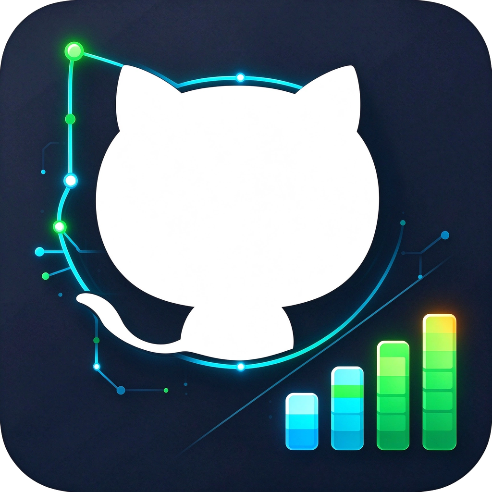

# 网络连通性自检

[](https://github.com/neurotracee/netcheck/blob/main/LICENSE)
[](https://github.com/neurotracee/netcheck/releases/latest)
[](https://github.com/neurotracee/netcheck/releases)
[](https://gitee.com/bio234/netcheck)
[](https://github.com/neurotracee/netcheck/actions/workflows/ci.yml)

**中文** | [English](#netcheck--network-connectivity-self-check)

> **本项目与 PDF 隐私打码工具同源同作者。** GitHub 仓库建得更早，Gitee 是同一名开发者维护的国内镜像
> （https://gitee.com/bio234/netcheck），两边内容一致，不存在谁抄谁。

一个纯本地、零依赖的网络连通性自检工具：**不代理、不加速、不改 hosts，只测量**。

它把 14 个常被卡住的目标逐个测一遍，每个目标拆成 **DNS 解析 → TCP 建连 → TLS 握手 → HTTP 首字节** 四段分别计时，
出一份 HTML 报告，一眼能看出是「解析不出来」「连不上」「能连上但握手被掐」还是「链路能用但很慢」。

Windows 端是一段 PowerShell 脚本，双击就跑，不安装任何东西；安卓端是一个 APK，点一下就开始测。
**两端共用同一套测试点位、同一套评级阈值、同一套报告样式**，手机测完和电脑测完的两份报告可以直接对着看。



---

## 这个项目是谁做的

- **指导作者：项目创作时为初中生。** 需求、测试点位的取舍、判读标准、验收测试全部由本人完成。
- **开发：腾讯 WorkBuddy × DeepSeek-V4.1-Flash。** 在指导作者的指令与反复验收下实现代码。
- **开源协议：Apache License 2.0。** 详见 [LICENSE](LICENSE)，署名与出处要求见 [ADDITIONAL-TERMS.md](ADDITIONAL-TERMS.md) 与 [NOTICE.md](NOTICE.md)。
- **维护方式**：个人业余时间维护，代码全部公开，欢迎任何人 fork 自行改进，不必询问。具体节奏与反馈渠道见文末「[维护节奏与反馈](#维护节奏与反馈)」。

## 关于署名（二次开发或商用前请先看这一段）

本项目**允许商用，也允许二次开发、允许闭源分发**（Apache-2.0 不是 copyleft，没有强制开源的传染性），
不需要付钱、不需要申请、不需要等作者批准（作者大约一两个月查看一次项目，回复可能很慢）。

但下面**三条是硬要求**，依据是 Apache-2.0 第 4 条 (b)(c)(d) 项与第 6 条（商标），详见 [ADDITIONAL-TERMS.md](ADDITIONAL-TERMS.md)：

### ① 保留作者署名

继续注明这两句，原文保留，不要替换成别人的名字：

```
指导作者：项目创作时为初中生
由 腾讯 WorkBuddy × DeepSeek-V4.1-Flash 开发
```

依据 Apache-2.0 第 4 条 (c) 项：必须保留源码中的版权、专利、商标与署名声明。

### ② 在程序里标注原项目地址

```
https://github.com/neurotracee/netcheck
https://gitee.com/bio234/netcheck      # mirror / 镜像（国内访问更快）
```

**必须让使用者看得见**——「关于」窗口、首页页脚、帮助菜单、报告页脚、`--about` 输出，任选一处即可。
只写在 `LICENSE` 文件或几百行开外的源码注释里**不算数**，因为使用者正常操作时看不到。

本项目的做法（可以直接照搬）：

| 位置 | 内容 |
| --- | --- |
| 安卓端首页页脚 | `原项目地址：https://github.com/neurotracee/netcheck` + `镜像（Gitee）：gitee.com/bio234/netcheck`（两行可点，点了复制） |
| 生成的 HTML 报告 | 报告页脚同样两行地址 |
| Windows 端 | 控制台首行与说明文档首屏 |

### ③ 改过的版本必须说明改过

只要你不是拿原版原样分发，就在程序里显著注明：

> 本程序基于 https://github.com/neurotracee/netcheck
> （镜像：https://gitee.com/bio234/netcheck）修改，非原作者发布。

依据 Apache-2.0 第 4 条 (b) 项：修改过的文件必须带上「已修改」的显著说明。

这一条是为了不让人误以为改动后的版本出自原作者——尤其是你的版本有 bug、有隐私风险、或者开始收费的时候。

### 除此之外，Apache-2.0 本身还要求

- **随分发附带协议与 NOTICE**：分发 APK 或脚本时，把 `LICENSE` 与 `NOTICE.md` 一并给出（第 4 条 (a)(d)）。
- **保留修改标记**：改过的源文件要写明改了什么（第 4 条 (b)）。
- **不要用作者的名义做背书**：不能暗示原作者为你的版本担保（第 6 条）。
- **换个名字**：程序名「网络连通性自检 / NetCheck」与图标不在授权范围内（第 6 条商标条款），
  fork 请改名换图标，避免别人误认。

需要闭源商用？**Apache-2.0 允许**，但上面三条署名与出处要求仍然有效。

---

## 测的是什么

每个目标按顺序测四段，分别计时，能精确定位卡在哪一步：

| 阶段 | 含义 | 失败说明 |
|---|---|---|
| DNS | 域名解析耗时 | 解析不出来 = DNS 污染或断网 |
| TCP | 到 443 端口的建连耗时 | 超时 = 端口不通，多半被阻断 |
| TLS | 加密握手耗时 | 超时 / 被重置 = SNI 干扰，典型表现就是「网站打不开但 ping 通」 |
| HTTP | 发出请求到收到首字节（TTFB） | 超时 = 链路被掐断 |

### 14 个测试点位

| 分组 | 点位 | 用途 |
|---|---|---|
| 基准 | 百度 `www.baidu.com` | 先确认本地宽带本身正常 |
| GitHub | API 接口 `api.github.com/rate_limit` | Agent 查仓库、拉元数据，顺带读出当前配额 |
| GitHub | Raw 原始文件 `raw.githubusercontent.com` | Agent 直接读取仓库里的文件内容 |
| GitHub | Git 传输 `github.com/.../info/refs` | git clone / pull 真正走的通道 |
| GitHub | 仓库打包 `codeload.github.com` | 下载仓库 zip / tar |
| GitHub | 主站 `github.com` | 网页 / 仓库首页 |
| GitHub | 静态资源 `github.githubassets.com` | 图标 / 页面资源 |
| GitHub | 头像 CDN `avatars.githubusercontent.com` | 头像 / 图片 |
| GitHub | Gist `gist.githubusercontent.com` | 代码片段、配置 |
| GitHub | Releases `objects.githubusercontent.com` | 发行包下载 |
| GitHub | Pages `github.io` | Pages 站点 |
| AI | Hugging Face `huggingface.co` | 模型 / 数据集 |
| 容器 | Docker 仓库 `registry-1.docker.io/v2/` | docker pull |
| 容器 | Docker Hub `hub.docker.com` | 镜像页 / 登录 |

报告顶部会显示 **API 配额**（未登录时是 60 次/小时），Agent 频繁调接口被限流时看这个数字。
「只测 GitHub 系」会跳过 Hugging Face 与 Docker 两项，测 11 个点位，快 3～8 秒。

## 判读

| 标签 | 依据 | 说明 |
|---|---|---|
| 优秀 | 建连 ≤ 120 ms | 和国内站点差不多快 |
| 良好 | ≤ 400 ms | 正常可用 |
| 一般 | ≤ 1000 ms | 能用但会卡顿 |
| 较慢 | > 1000 ms | 几乎没法用 |
| 受限 | TCP 通、TLS 失败 | 最典型的「被墙」状态 |
| 不通 | TCP 都连不上 | 完全阻断 |

报告里的 **DoH 真实解析**：用阿里公共 DNS 加密查询拿到该域名的真实 IP，和本机解析结果对比。
两者不一致，说明本机 DNS 被改写或被污染；如果本机 IP 显示 `127.0.0.1`，说明域名被 hosts 接管了。

## 和瓦特工具箱是什么关系

瓦特工具箱（Watt Toolkit，原名 Steam++）的加速思路是：

```
hosts 把域名指向 127.0.0.1
      ↓
本机跑一个 YARP 反向代理（监听 80/443）
      ↓
反代用自己的线路去连真实服务器
      ↓
浏览器以为在直连，实际走的是本机反代（中间人，靠自签根证书解密）
```

这个工具的定位不一样：**它不代理，只测量**。
所以最实用的用法是——加速器关着跑一次，开着再跑一次，两份报告对比，立刻就能看出加速到底有没有生效、哪个域名还在掉。

需要注意两种模式的差异：

- **hosts 模式**：域名解析到 127.0.0.1，报告里的 IP 会显示 127.0.0.1，测到的延迟其实是「你到本地反代」的延迟，不代表到真实服务器的速度
- **系统代理模式**：本工具用原生 socket 直连，不走系统代理，所以测到的仍是真实直连状况——正好可以用来判断「如果不加速会有多惨」
- **安卓端的 VPN 模式**（Clash 类工具）：VPN 在系统层接管流量，socket 无法绕过，这时测到的就是「走规则后的结果」。报告顶部会标「VPN 已启用」，看数值时请把这层算进去

## 怎么用

### 方式一：Windows，双击就跑

1. 到 **[Releases 页面](https://github.com/neurotracee/netcheck/releases/latest)** 下载 `NetCheck-Windows.zip`（或直接下载仓库里 `windows/` 目录的两个文件；国内网络慢可以去 [Gitee 发布页](https://gitee.com/bio234/netcheck/releases/latest)，两边是同一个包）。
2. 解压，双击 **一键网络自检.bat**，会出现一个菜单：

   ```
   [1] 开始自检（14 个点位，约 30 秒）
   [2] 只测 GitHub 系（更快）
   [3] 关于与开源信息
   [4] 设置（报告位置 / 自动打开 / 超时）
   [0] 退出
   ```

   菜单顶部常驻署名、协议与两个项目地址——这个工具是谁做的、从哪儿来的，直接摆在最显眼的地方。
3. 选 1（或 2），逐个测试 14 个目标，大约 15～40 秒（看网络差到什么程度）。
4. 测完自动用默认浏览器打开报告，报告同时存到 `reports\latest.html`，历史记录按时间戳各存一份 HTML + CSV。
   不想让它自动弹浏览器，就在「设置」里关掉。

不需要安装 PowerShell 模块、不需要 Python、不需要联网安装任何东西——用的是 Windows 自带的 PowerShell 5.1。
如果系统提示「无法加载文件，因为在此系统上禁止运行脚本」，用 bat 启动即可（bat 里已经带了 `-ExecutionPolicy Bypass`）。

### 方式二：安卓，装 APK

1. 到 **[Releases 页面](https://github.com/neurotracee/netcheck/releases/latest)** 下载 `NetCheck-<版本号>.apk`（Android 8.0 及以上，通用包，不挑 CPU 架构）。
2. 点开安装；系统提示「未知来源」时，允许当前文件管理器安装即可。
3. 打开应用，点 **开始自检**。测的过程中能看到「正在测试 3 / 14 · GitHub API 接口」。
4. 测完：每行可点开看细节（状态码、DoH 对照、四段耗时）；点 **导出报告** 把 HTML 交给你（见下面的保存位置说明），点 **分享 CSV** 导出原始数据。
5. 右上角 **齿轮** 进设置：界面语言（中文 / English）、外观（跟随系统 / 浅色 / 深色）、
   报告保存位置、更新检查方式、更新源（Gitee / GitHub）、版本与更新；最下面是 **关于与开源信息**
   （署名、协议、两个地址、隐私说明、二次开发三条硬要求）。

**报告保存位置**：默认走系统分享面板（发微信、发邮件、存到「文件」都行）；在设置里选了一个文件夹之后，
导出就直接写进那个文件夹，不再弹分享面板。

权限两个，都只服务于测量本身：`INTERNET`（发起 socket 连接）、`ACCESS_NETWORK_STATE`（读当前网络类型、代理、私有 DNS、DNS 服务器）。
没有存储权限——报告写在应用私有目录，导出时由你指定落地位置（SAF 授权，只给那一个目录）。
不做任何统计埋点，不上传任何数据；联网只有两处：自检本身，以及更新检查（只读一个公开版本号，
默认启动时静默查一次，可在设置里改成纯手动）。

### 方式三：从源码跑 Windows 端

```powershell
powershell -ExecutionPolicy Bypass -File .\windows\netcheck.ps1
```

进阶用法：

```powershell
# 只测 GitHub 系（快一些）
powershell -ExecutionPolicy Bypass -File .\windows\netcheck.ps1 -Quick

# 测完不自动打开浏览器
powershell -ExecutionPolicy Bypass -File .\windows\netcheck.ps1 -NoBrowser

# 只弹「关于与开源信息」窗口
powershell -ExecutionPolicy Bypass -File .\windows\netcheck.ps1 -About

# 只弹设置窗口（报告存哪、要不要自动打开、单段超时）
powershell -ExecutionPolicy Bypass -File .\windows\netcheck.ps1 -Settings
```

设置写在脚本同目录的 `settings.json`（不写注册表、不联网），删掉它就恢复默认。

想换测试目标，用记事本打开 `windows/netcheck.ps1`，改开头 `$Targets` 那段，照着格式加一行就行：

```powershell
@{ Name = '某个站点'; Host = 'example.com'; Path = '/'; Desc = '备注' }
```

安卓端要改点位，改 `android/app/src/main/java/com/neurotracee/netcheck/net/Targets.kt` 的 `all` 列表，字段一一对应。

## 自己打包

Windows 端不需要打包：`.ps1` 是纯文本脚本，`bat` 只是个启动器。

安卓 APK：JDK 17 + Android SDK 34 + Gradle 8.7。

```bash
cd android
gradle assembleRelease
```

产物在 `android/app/build/outputs/apk/release/app-release.apk`。
签名配置读 `android/keystore.properties`（不入仓库），没有这个文件时会打出未签名的 release 包。
完整步骤、签名怎么生成、产物怎么核对，见 [docs/05-构建与发布.md](docs/05-构建与发布.md)。

## 已知限制

- **测的是 TCP/TLS 握手延迟，不等于下载速度。** 要测带宽得另外传大文件，本工具不做。
- **只测 IPv4、TLS 1.2。** 两端一致：安卓端强制 `TLSv1.2`，与桌面端 `SslProtocols::Tls12` 对齐，保证两台设备上的数值可比。
  代价是某些只支持 TLS 1.3 的站点会被判「受限」，目前 14 个点位里没有这种站点。
- **为了测纯网络连通性，证书校验被忽略。** 所以「证书链有问题但能连上」的情况，报告会显示正常。
- **超时统一 3 秒。** 网络特别差的时候，某些目标可能本来 5 秒能连上也被判失败——重跑一次看是否稳定即可。
- **安卓端拿不到的三项信息，用等价项替代**（这是两端报告唯一的结构性差异）：
  - 「本机 443 端口是否有程序在监听」→ 安卓不允许普通应用枚举端口，改为显示 **VPN 是否启用** 与 **私有 DNS 模式**；
  - 「系统代理」→ 安卓读的是 `ConnectivityManager` 的默认代理，不是 IE 那种注册表设置；
  - 「hosts 映射」→ 读 `/system/etc/hosts`，安卓上这个文件通常为空，读到几条就显示几条。
- **安卓 7 及以下不支持**（`minSdk 26`）。要用更低版本得自己改 `app/build.gradle.kts` 并处理 `privateDns` 相关的 API 差异。
- **每次运行都会在报告目录留一份 HTML 和 CSV**，觉得多了可以自己删（Windows 在 `reports/`，安卓在应用私有目录，卸载即清空）。

## 依赖与许可

| 依赖 | 版本 | 用途 | 许可 |
| --- | --- | --- | --- |
| Windows PowerShell（.NET Framework） | 系统自带 5.1+ | 脚本运行时 | 随 Windows 分发 |
| [AndroidX](https://developer.android.com/jetpack/androidx)（core-ktx / lifecycle / activity-compose） | 1.13.1 / 2.8.4 / 1.9.1 | 安卓基础框架 | Apache-2.0 |
| [Jetpack Compose](https://developer.android.com/jetpack/compose)（ui / foundation / material3 / material-icons-core） | BOM 2024.06.00 | 界面 | Apache-2.0 |
| [Kotlin 标准库](https://kotlinlang.org/) | 1.9.24 | 语言运行时 | Apache-2.0 |
| Android Gradle Plugin / Gradle | 8.4.2 / 8.7 | 构建（不进入产物） | Apache-2.0 |
| JUnit 4 / kotlin-test | 4.13.2 / 1.9.24 | 单元测试（不进入产物） | EPL-1.0 / Apache-2.0 |

**没有任何需要单独声明的第三方隐私/网络库**：探测内核是原生 `java.net.Socket` + `javax.net.ssl`，
界面是 Compose，HTTP 请求是手写的（就为了能分段计时）。所以 APK 里没有 OkHttp、没有统计 SDK、没有广告 SDK。
完整声明见 [NOTICE.md](NOTICE.md)。

## 隐私说明

- **不代理、不改系统设置、不写 hosts。** 全程只发起连接、只读响应头。
- **不联网上报任何东西。** 对外只发起这些连接：14 个测试点位本身、一次 DoH 对照查询（发往阿里公共 DNS）、
  以及安卓端启动时的一次更新检查（只读 Gitee 或 GitHub 上一个公开的版本号，不传本机任何信息，可在设置里关掉）。
- **报告不出本机。** Windows 端写在 `reports/`（或你在设置里指定的目录）；安卓端写在应用私有目录，只有你主动点「导出」才会离开应用。
- **报告里只包含**：点位名、域名、解析到的 IP、四段耗时、HTTP 状态码、评级。不含设备标识、不含账号、不含浏览记录。
- **安卓端不读通讯录、不读短信、不读相册、不要存储权限。**
- **Windows 端不用管理员权限、不写注册表**，设置只存在脚本同目录的 `settings.json`。
- 生成的 HTML 报告是**静态文件**，没有任何外链脚本或图片，断网也能打开。

## 许可

Apache License 2.0，见 [LICENSE](LICENSE)。
署名与出处要求（第 4 条与第 6 条的落地写法）见 [ADDITIONAL-TERMS.md](ADDITIONAL-TERMS.md)，第三方组件声明见 [NOTICE.md](NOTICE.md)。

```
Copyright (C) 2026 项目创作时为初中生

Licensed under the Apache License, Version 2.0 (the "License");
you may not use this file except in compliance with the License.
You may obtain a copy of the License at

    http://www.apache.org/licenses/LICENSE-2.0

Unless required by applicable law or agreed to in writing, software
distributed under the License is distributed on an "AS IS" BASIS,
WITHOUT WARRANTIES OR CONDITIONS OF ANY KIND, either express or implied.
See the License for the specific language governing permissions and
limitations under the License.
```

## 文档

| 想看什么 | 去哪 |
| --- | --- |
| 这一版更新了什么、修了什么 | [CHANGELOG.md](CHANGELOG.md) |
| 文档地图：哪个文件在哪、怎么找 | [DOCS.md](DOCS.md) |
| Windows / 安卓 完整操作说明 | [docs/01](docs/01-使用说明-Windows.md) · [docs/02](docs/02-使用说明-安卓.md) |
| 检测方法与判读标准 | [docs/03](docs/03-检测方法与判读标准.md) |
| 常见问题 | [docs/04](docs/04-常见问题.md) |
| 打包、测试、发版 | [docs/05](docs/05-构建与发布.md) |
| 怎么发 Release（网页一步步点） | [docs/06](docs/06-发布Release操作指南.md) |
| 想参与改进、提缺陷、加点位 | [CONTRIBUTING.md](CONTRIBUTING.md) |

安卓端没有单独的 README：两端的能力、许可、署名共用一套说法，写两份必然一头改了一头忘。

## 维护节奏与反馈

这个项目由个人在业余时间维护，取舍很直白：**测不准、判读误导、结果不稳定**这类问题优先处理；界面润色、锦上添花的功能可以慢慢来。代码全部公开，任何人不经询问就可以 fork 自行改进，不必等作者回复。

- **报缺陷**：到 [Issues](https://github.com/neurotracee/netcheck/issues/new/choose) 按模板填，写清版本号、系统/机型、哪几个点位、报告截图。两端 Issues 都开着，Gitee 那边也行（[Gitee Issues](https://gitee.com/bio234/netcheck/issues)）。
- **提改进 / 提代码**：先看 [CONTRIBUTING.md](CONTRIBUTING.md)，里面有目录结构、怎么跑自检、以及提交时会被要求做什么。
- **回复可能不快**：看到了会处理，没回不代表没看见，也不代表被否掉。

## 赞赏

如果这个项目帮你省了时间，可以请我喝杯奶茶 🧋


> **点 Star 比打赏更有用。**不想花钱完全没问题：到仓库点一颗 Star 就是最好的支持，别人搜得到，我才更有动力维护。
>
> 国内用户也可以扫码请我喝杯奶茶——完全自愿，不打赏一样免费、功能不缺。

---

---

# NetCheck — Network Connectivity Self Check

[中文](#网络连通性自检) | **English**

> **This project has the same author as PDF Privacy Masker.** The GitHub repository was created first;
> Gitee (https://gitee.com/bio234/netcheck) is the developer's own mirror for faster access in mainland China.

A local-only, dependency-free connectivity probe. **It does not proxy, does not accelerate, does not touch hosts — it only measures.**

It times 14 targets that commonly break, splitting each one into **DNS → TCP connect → TLS handshake → HTTP time-to-first-byte**, four separately measured stages, then writes an HTML report. One glance tells you whether the problem is resolution, connection, handshake interference, or a slow-but-working link.

The Windows build is a single PowerShell script you double-click; the Android build is an APK.
Both share the **same target list, same grading thresholds, same report layout**, so a phone report and a desktop report can be compared side by side.

**License:** Apache License 2.0 — commercial use, modification and closed-source redistribution are all permitted.
Attribution and project-URL requirements are described in [ADDITIONAL-TERMS.md](ADDITIONAL-TERMS.md) (Apache-2.0 §4 and §6) and are part of the terms.

**Privacy:** no upload, no telemetry, no proxy, no hosts modification. The only outbound connections are the 14 test targets plus one DNS-over-HTTPS lookup to Alibaba Public DNS used as a ground-truth comparison.

**Permissions (Android):** `INTERNET` and `ACCESS_NETWORK_STATE` only — both needed to make sockets and to read the current network's proxy / private-DNS / DNS-server state. No storage permission, no contacts, no telemetry.
