# GitHub 网络自检

[](https://github.com/neurotracee/github-netcheck/blob/main/LICENSE)
[](https://github.com/neurotracee/github-netcheck/releases/latest)
[](https://github.com/neurotracee/github-netcheck/releases)
[](https://gitee.com/bio234/github-netcheck)
[](https://github.com/neurotracee/github-netcheck/actions/workflows/ci.yml)

**中文** | [English](#netcheck--github-network-self-check)

> **本项目与 PDF 隐私打码工具同源同作者。** GitHub 仓库建得更早，Gitee 是同一名开发者维护的国内镜像
> （https://gitee.com/bio234/github-netcheck），两边内容一致，不存在谁抄谁。
>
> 作者的另一项目：**PDF 隐私打码工具**（本地离线给 PDF 打码，不上传文件）——
> GitHub：https://github.com/neurotracee/pdf-privacy-masker
>
> Gitee：https://gitee.com/bio234/pdf-privacy-masker
>
> 那个项目用 AGPL-3.0，本项目用 Apache-2.0，协议不同，别混用。

一个纯本地、零依赖的网络连通性自检工具，专门盯着**中国大陆能不能连上 GitHub 系服务**：**不代理、不加速、不改 hosts，只测量**。

<p align="center">
  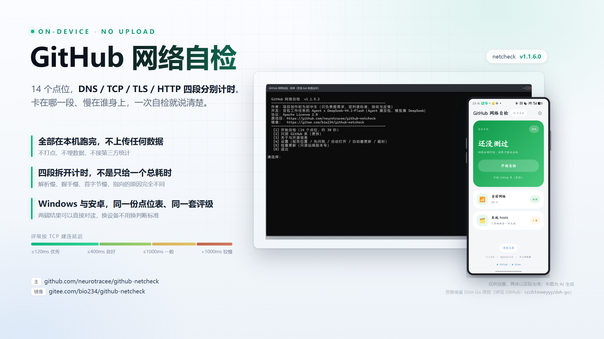
</p>
<p align="center">
  <sub>↑ 主视觉设计图：构图、配色与文案是设计的；两侧画面分别是 Windows 控制台的真实输出和安卓端真机截图，界面内容没有改过。<br>
  右下角两行小字（「仅供创意，具体以实际为准；本图为 AI 生成」＋「思路借鉴 DSH Go 项目，详见 GitHub：ccch1mneyyy/dsh-go」）是这张图自己的声明，不代表界面长成什么样——真实界面见下面的截图一节。</sub>
</p>

> **创建时间**：本项目创建于 **2026 年 11 月 14 日**，同日完成 Windows 端脚本、安卓端 APK 与两平台仓库（GitHub `neurotracee/github-netcheck`、Gitee `bio234/github-netcheck`）。

> **关于名字**：本项目原名「网络连通性自检」，容易被理解成泛泛的测网速工具。它的实际用途是排查 GitHub（含 Pages、raw、
> API、对象存储、克隆下载）以及 Hugging Face、Docker 这些常被卡住的开发资源，所以从 1.1.0.3 起两端统一改名为 **GitHub 网络自检**；
> 仓库名也从 `netcheck` 改成了 **`github-netcheck`**（GitHub 与 Gitee 两边一起改，旧链接会跳转到新地址），
> 免得仓库名里只剩下一个宽泛的「网络检查」。包名 `com.neurotracee.netcheck` 与脚本名 `netcheck.ps1` 没动——
> 包名一改，手机上装过的旧版就没法覆盖升级了。

**关键词（给搜索用的标签）**：GitHub 连不上 排查 · GitHub 加速检测 · GitHub Pages 打不开 · raw.githubusercontent 加载失败 ·
网络连通性自检 · 连通性检测 · DNS 解析 / TCP 建连 / TLS 握手 / HTTP 首字节（四段分别计时）· 延迟测试 · hosts 映射检查 · 系统代理检查 ·
Hugging Face 下载慢 · Docker 拉取失败 · 国内网络环境 · Android APK · PowerShell 脚本 · Kotlin / Jetpack Compose · Apache-2.0 · 零第三方依赖

它把 14 个常被卡住的目标逐个测一遍，每个目标拆成 **DNS 解析 → TCP 建连 → TLS 握手 → HTTP 首字节** 四段分别计时，
出一份 HTML 报告，一眼能看出是「解析不出来」「连不上」「能连上但握手被掐」还是「链路能用但很慢」。

Windows 端是一段 PowerShell 脚本，双击就跑，不安装任何东西；安卓端是一个 APK，点一下就开始测。
**两端共用同一套测试点位、同一套评级阈值、同一套报告样式**，手机测完和电脑测完的两份报告可以直接对着看。

---

## 界面

<h3 align="center">两端界面</h3>

<p align="center">
  两端全部是真机截图，没有拼图、没有示意。图上看到的话术，就是程序里正在用的那一套。<br>
  安卓界面内置中英双语（「设置 → 界面语言」，默认跟随系统）；Windows 端目前是中文界面。下面是中文界面，英文界面截图和英文说明统一放在本文最后的英文段。
</p>

<h3 align="center">安卓：跑完一次，结论一眼看完</h3>
<p align="center">主界面 · 结果 · 历史 · 历史详情。14 个点位逐条给出 DNS / TCP / TLS / HTTP 四段耗时，异常默认置顶，历史里能回看每一次。</p>

<p align="center">
  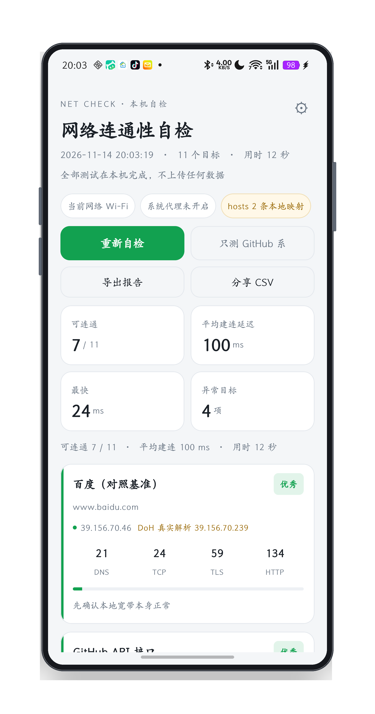
  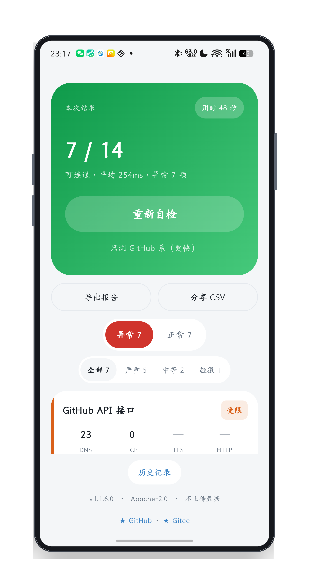
  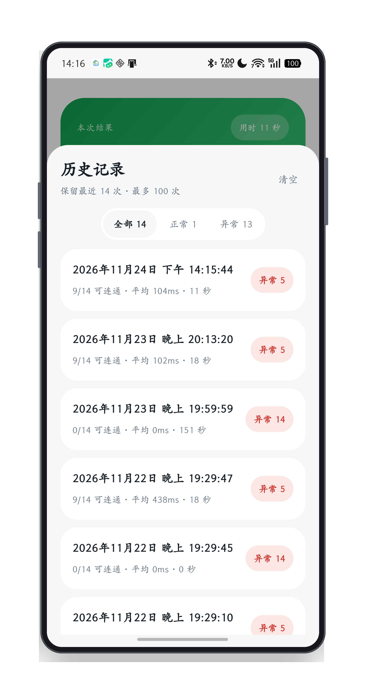
  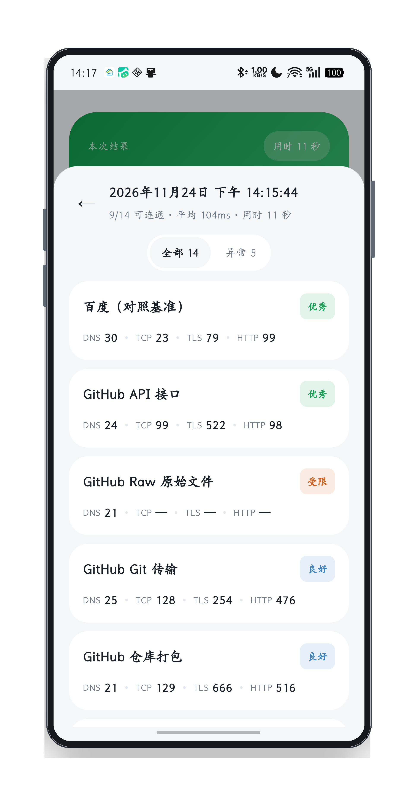
</p>
<p align="center">
  <sub>↑ 这四张都是中文浅色。深色版统一放在文末的英文段——纯粹是两种语言各担一半截图任务，同一组界面不用重复出四张，不代表哪种语言只配哪种主题；两个语言、两种主题在应用里对所有人都是同样可选的。<br>
  图中那两条「中途停止 · 已测 5/14」是截图时真的按了停止，不是摆拍。</sub>
</p>

<br>

<h3 align="center">Windows：控制台才是主程序</h3>
<p align="center">双击「一键网络自检.bat」，<strong>先出来的是这张菜单</strong>：输入数字选功能，选 1 直接开测、选 3 弹关于窗、选 4 弹设置窗、选 5 只查更新、选 0 退出。<br>
选完 1 才开始跑，跑完就是下面第二张。那两个弹窗只是壳，主界面自始至终是控制台。</p>

<p align="center">
  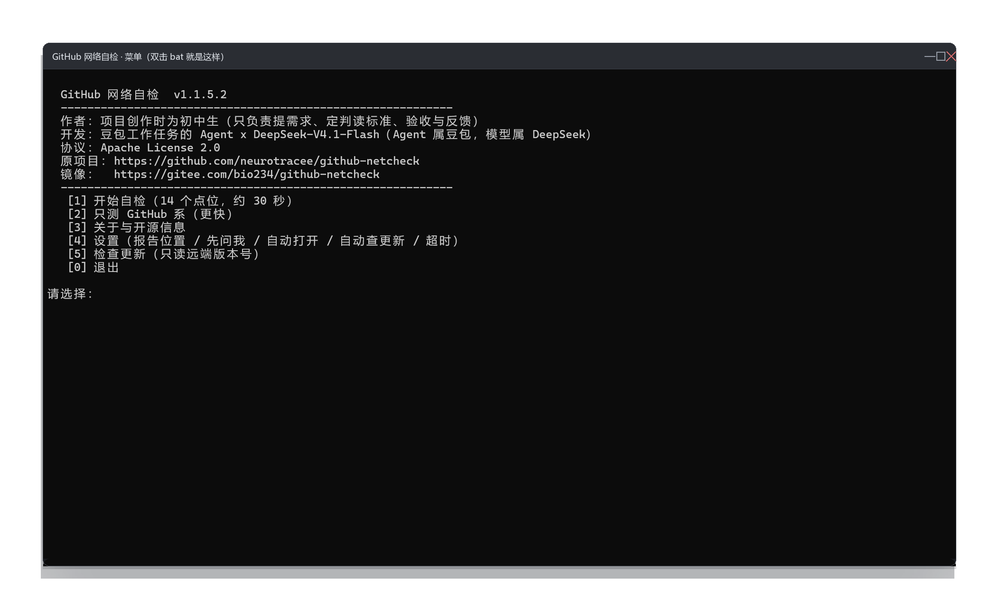
</p>
<p align="center">
  <sub>↑ 执行前：刚打开就长这样，标题、作者与两个仓库地址写在最上面，「请选择：」在等你输数字</sub>
</p>

<p align="center">
  
</p>
<p align="center">
  <sub>↑ 执行后：选 1 跑完全部 14 个点位。长的那两行是连接失败时的原始异常信息，没做美化</sub><br>
  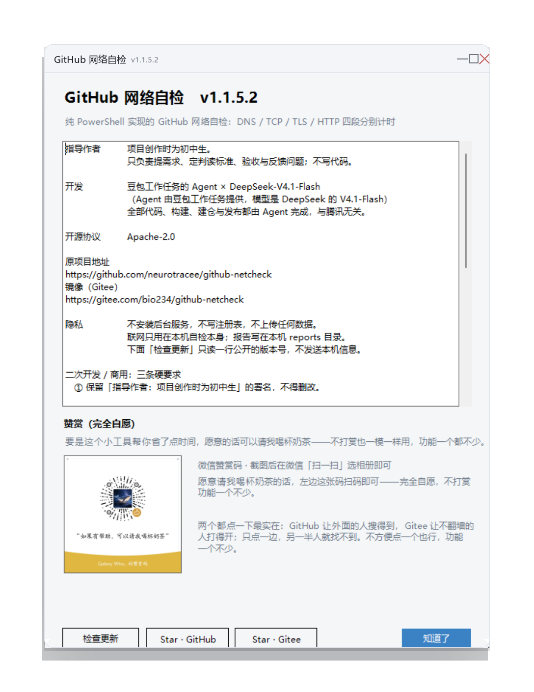
  <br><sub>↑ 选 3 弹出的「关于与开源信息」窗，不是主界面</sub>
</p>

<br>

| 界面 | 说明 |
| --- | --- |
| 安卓 · 主界面 | 标题区 + 点位数胶囊 + 齿轮入口；主卡显示当前状态与「开始自检」；下面两张信息卡说明当前网络与本地 hosts |
| 安卓 · 结果页 | 汇总卡 + 「导出报告 / 分享 CSV」；默认只列异常，顶部「异常 / 正常」可点可滑，异常内再分「严重 / 中等 / 轻微」 |
| 安卓 · 历史记录 | 顶部「全部 / 正常 / 异常」按次数筛，异常内再三档；每条记录写清时间和结果，中途停止的标「未测完」 |
| 安卓 · 历史详情 | 单次结果，逐点位四段耗时，可在「全部 / 异常」之间切 |
| 安卓 · 设置页 | 界面语言 / 外观 / 报告保存位置 / 更新检查方式 / 更新源（自动默认 Gitee / 只用 Gitee / 只用 GitHub）/ 版本与检查更新 / 关于入口 |
| 安卓 · 关于页 | 指导作者、开发（豆包工作任务的 Agent × DeepSeek-V4.1-Flash）、协议、两个地址、隐私、三条硬要求、测试方法、维护节奏 |
| Windows · 菜单页（入口） | 双击 .bat 立刻出现：标题区 + 作者 / 开发 / 协议 / 两个地址 + `[1]`–`[5]` 五项 + `[0]` 退出 +「请选择：」 |
| Windows · 控制台（选 1 的结果） | 14 个点位逐条给出 DNS / TCP / TLS / HTTP 四段耗时，末尾汇总「可连通 X/14、平均建连、耗时、最快 / 最慢 / 不通」 |
| Windows · 关于窗 | 选项 3 弹出：同一份「关于与开源信息」文案，外加赞赏码与两个仓库的 Star 直达按钮 |

> 手机图是 v1.1.6.0 真机重拍的（11 月 20 日）：中文四张浅色、英文四张深色。之所以一浅一深，只是两种语言各担一半截图任务，不是给哪种语言配哪种主题——应用里语言和主题都能各自单独选，理由在文末英文段里也写了一遍。
> 设置页与关于页暂时沿用旧图（功能未改，但关于页版本号仍是 1.1.5.5，且缺新增的「测试方法」段落），后面补拍。
> 关于窗那张是 v1.1.5.2 重拍的；控制台菜单页是 v1.1.5.2 刚截的（双击 .bat 的原样）。
> 套壳脚本：手机 `docs/tools/frame_ui.py`（机身壳，批量用 `frame_batch.py`），Windows `docs/tools/frame_window.py`（窗口壳）；换新截图重跑一遍就行，不用手工修图。
> 英文界面的截图统一放在本文最后（英文段内的 Screenshots 一节），不在这里和中文图混排。

---

## 下载（先点这里）

**当前版本：安卓 v1.1.6.1 ・ Windows v1.1.5.2**。两个平台内容一样，选能打开的就行（国内网络慢优先 Gitee）。

| 你要的 | GitHub | Gitee（国内镜像） |
| --- | --- | --- |
| 最新下载页 | https://github.com/neurotracee/github-netcheck/releases/latest | https://gitee.com/bio234/github-netcheck/releases/latest |
| 安卓 APK | https://github.com/neurotracee/github-netcheck/releases/download/v1.1.6.1/NetCheck-1.1.6.1.apk | https://gitee.com/bio234/github-netcheck/releases/download/v1.1.6.1/NetCheck-1.1.6.1.apk |
| Windows 包（zip） | https://github.com/neurotracee/github-netcheck/releases/download/v1.1.5.2/NetCheck-Windows.zip | https://gitee.com/bio234/github-netcheck/releases/download/v1.1.5.2/NetCheck-Windows.zip |
| 仓库首页 | https://github.com/neurotracee/github-netcheck | https://gitee.com/bio234/github-netcheck |

解压 Windows 包后双击 **一键网络自检.bat**；APK 直接安装（系统会提示「未知来源」，原因见下一节）。
校验值（SHA-256）写在 [Release 说明](https://github.com/neurotracee/github-netcheck/releases/latest) 里，下载后可用 `certutil -hashfile <文件名> SHA256` 自己核一遍。

> **Gitee 下载 APK 变成 .zip 后缀？不是文件坏了。** Gitee 的下载服务器按文件头识别类型，把 APK 判成了 `application/zip` 发给你，
> 部分手机浏览器（例如 Edge 手机版）就顺手把文件名改成 `.zip`。把后缀改回 `.apk` 就能照常安装，文件内容一模一样。
> 嫌麻烦就直接去 GitHub 下载页拿 APK（那边按 `application/vnd.android.package-archive` 发送，不会改后缀）。

### 旧版本附件放在哪里（Gitee 容量有限）

Gitee 的附件总容量只有 1GB，装不下所有历史包，所以安装包在两端的留存分三档，**Windows 与安卓同样对待**：

| 版本档位 | GitHub | Gitee（国内镜像） |
| --- | --- | --- |
| **最新版**（安卓 v1.1.6.1 的 APK、Windows v1.1.5.2 的 zip） | 保留附件 | **保留附件** |
| **上一版**（v1.1.6.0 的安卓 APK、v1.1.5.1 的 Windows zip） | 保留附件 | 保留附件（方便覆盖升级过渡） |
| **更早的旧版本** | 保留全部附件 | **附件已撤下**，只留发布说明 |

也就是说：**最新版和上一版的 Windows 包、安卓包在 Gitee 都能下**；只有更早的旧版本才需要到 GitHub 发布页找。
旧版本下载地址：https://github.com/neurotracee/github-netcheck/releases （Gitee 对应旧发布页里也会注明「旧版请到 GitHub 下载」并给出链接）。

**觉得有用就走，不用付钱。** 两个都点一下最实在：GitHub 那颗让国外和搜索引擎找到它，Gitee 那颗让不翻墙的人也打得开；只点一边，另一半人就搜不到——差一颗星，少一半人。不方便的话点一个就够。
[GitHub Star（标星）](https://github.com/neurotracee/github-netcheck) ｜ [Gitee Star（收藏）](https://gitee.com/bio234/github-netcheck)
要是这个小工具帮你省了点时间、愿意请我喝杯奶茶，文末「[赞赏](#赞赏)」一节有张微信赞赏码，**完全自愿，不打赏功能一个都不少**。

**版本说明**：这是四段版本号（主.次.修订.补丁），小修小改只加最后一段。所以 1.1.2.0 → 1.1.3.2 属于功能级更新（赞赏入口 + 启动查更新提示），
而 1.1.3.2 → 1.1.3.2 是**纯文案更新**：把「图标里含 GitHub 的 Octocat、本项目无授权无背书、仅限非商业使用、请勿复用图标」这段声明
写进了两端程序内部（关于页、控制台、报告页脚），功能一行没动。

## 装之前先看三件事

**① 为什么只在 Releases 下载，没上应用商店。**
作者是未成年人，华为 / 小米 / OPPO / vivo 四家应用市场的开发者上架要做互认证：手持身份证拍照 + 绑定**本人实名银行卡**。
作者拿不到本人实名银行卡（未成年人办不了），家里对「上传身份证 + 银行卡」这套流程也不理解、警惕被骗的心思很重，
所以这条路走不通，不是懒。因此 APK 直接放在 GitHub / Gitee 的 Releases 里，用作者自签证书签名，
系统会提示「未知来源」——**这是没走应用商店的必然结果，不是应用本身有问题**。

**② 安装时那句「信息可能会被第三方收集」是什么。**
那是安卓系统（尤其国产 ROM 的安装器）对**任何非应用商店来源的 APK** 统一弹的风险提示，说给所有人听，
不是针对本应用，也不代表本应用会收集什么。本应用申请的权限只有三项（`INTERNET`、`ACCESS_NETWORK_STATE`、
`REQUEST_INSTALL_PACKAGES`——最后一项只用于更新时把下好的安装包交给系统安装器，系统会再问一次是否安装），
没有存储、位置、通讯录、短信、相机权限，也没有任何统计 / 广告 / 崩溃上报 SDK（可对照
[AndroidManifest.xml](android/app/src/main/AndroidManifest.xml) 与 [NOTICE.md](NOTICE.md) 自行核对）。
签名证书指纹写在 Release 说明里，可以自己验。

**关于签名本身**（1.1.0.3 起）：APK 用 **APK Signature Scheme v2 + v3** 双重签名（v2 供 Android 7–8 校验，v3 供 9 及以上校验，
比只签 v2 更稳，部分国产 ROM 的安装器会严格检查 v3）。证书是自签的，DN 为
`CN=NetCheck, OU=OpenSource, O=neurotracee, L=Datong, ST=Shanxi, C=CN`，
SHA-256 指纹 `c43205775efaf5d088b646d6999e81e08213c43969b3140b541c29d0c7bb8b5a`——自行核对命令：

```text
apksigner verify -v --print-certs NetCheck-<版本号>.apk
```

自签证书的含义只是「没有商业 CA 背书」，不等于不安全；**它不是应用商店的护照，也不影响覆盖升级**。
从 1.0.0.0 到 1.1.0.3 一直是同一把密钥，所以旧版可以直接覆盖安装，不用卸载。

**③ 它到底连了什么网。**
联网权限只有一项 `INTERNET`，只用在三件事：**启动时自动检查更新（可在设置里关掉）**、
**手动点「检查更新」**、**测那 14 个点位的延迟**。
检查更新只连**两个仓库**——国内 Gitee（https://gitee.com/bio234/github-netcheck）、国外 GitHub
（https://github.com/neurotracee/github-netcheck），由脚本按可用的那个自动择一，读一行公开的版本号。
**不上传任何信息、不传文件、不带账号、不带设备标识**；测延迟时也只发连接和一次响应头读取，不提交内容。


---

## 这个项目是谁做的

- **指导作者：项目创作时为初中生。** 只负责三件事：提出需求、确定测试点位的取舍与判读标准、验收并反馈问题。他不写代码。
- **开发：豆包工作任务的 Agent × DeepSeek-V4.1-Flash。** 全部施工——两个端的代码、构建、签名、新建仓库与发布——都由 Agent 在他反复提需求与反馈下完成。
- **名词说明（别混淆）**：**Agent 由豆包工作任务提供**，**模型是 DeepSeek 的（V4.1-Flash，由指导作者自己在客户端选定）**。所以这不是「豆包的模型」，也不是腾讯的产品，跟腾讯没有任何关系。
- **开源协议：Apache License 2.0。** 详见 [LICENSE](LICENSE)，署名与出处要求见 [ADDITIONAL-TERMS.md](ADDITIONAL-TERMS.md) 与 [NOTICE.md](NOTICE.md)。
- **维护方式**：个人业余时间维护，代码全部公开，欢迎任何人 fork 自行改进，不必询问。具体节奏与反馈渠道见文末「[维护节奏与反馈](#维护节奏与反馈)」。

## 关于署名（二次开发或商用前请先看这一段）

本项目**允许商用，也允许二次开发、允许闭源分发**（Apache-2.0 不是 copyleft，没有强制开源的传染性），
不需要付钱、不需要申请、不需要等作者批准（作者大约一两个月查看一次项目，回复可能很慢）。

但下面**三条是硬要求**，依据是 Apache-2.0 第 4 条 (b)(c)(d) 项与第 6 条（商标），详见 [ADDITIONAL-TERMS.md](ADDITIONAL-TERMS.md)：

### ① 保留作者署名

继续注明这两句，原文保留，不要替换成别人的名字：

```
指导作者：项目创作时为初中生
由 豆包工作任务的 Agent × DeepSeek-V4.1-Flash 开发
```

依据 Apache-2.0 第 4 条 (c) 项：必须保留源码中的版权、专利、商标与署名声明。

### ② 在程序里标注原项目地址

```
https://github.com/neurotracee/github-netcheck
https://gitee.com/bio234/github-netcheck      # mirror / 镜像（国内访问更快）
```

**必须让使用者看得见**——「关于」窗口、首页页脚、帮助菜单、报告页脚、`--about` 输出，任选一处即可。
只写在 `LICENSE` 文件或几百行开外的源码注释里**不算数**，因为使用者正常操作时看不到。

本项目的做法（可以直接照搬）：

| 位置 | 内容 |
| --- | --- |
| 安卓端首页页脚 | `原项目地址：https://github.com/neurotracee/github-netcheck` + `镜像（Gitee）：gitee.com/bio234/github-netcheck`（两行可点，点了复制） |
| 生成的 HTML 报告 | 报告页脚同样两行地址 |
| Windows 端 | 控制台首行与说明文档首屏 |

### ③ 改过的版本必须说明改过

只要你不是拿原版原样分发，就在程序里显著注明：

> 本程序基于 https://github.com/neurotracee/github-netcheck
> （镜像：https://gitee.com/bio234/github-netcheck）修改，非原作者发布。

依据 Apache-2.0 第 4 条 (b) 项：修改过的文件必须带上「已修改」的显著说明。

这一条是为了不让人误以为改动后的版本出自原作者——尤其是你的版本有 bug、有隐私风险、或者开始收费的时候。

### 除此之外，Apache-2.0 本身还要求

- **随分发附带协议与 NOTICE**：分发 APK 或脚本时，把 `LICENSE` 与 `NOTICE.md` 一并给出（第 4 条 (a)(d)）。
- **保留修改标记**：改过的源文件要写明改了什么（第 4 条 (b)）。
- **不要用作者的名义做背书**：不能暗示原作者为你的版本担保（第 6 条）。
- **换个名字**：程序名「GitHub 网络自检 / NetCheck」与图标不在授权范围内（第 6 条商标条款），
  fork 请改名换图标，避免别人误认。

需要闭源商用？**Apache-2.0 允许**，但上面三条署名与出处要求仍然有效。

### ④ 图标（重要，这一段优先于上面任何与图标相关的表述）

**图标里有一只 GitHub 的猫。** 本项目的图标（`assets/icon/` 下的 png 与 ico，以及 Windows 端和安卓端的应用图标）中，
猫头剪影来自 GitHub 的吉祥物 **Octocat**。**Octocat® 是 GitHub, Inc. 的注册商标**（GitHub, Inc. 现为 Microsoft 旗下公司），
该形象另在美国版权局做过作品登记。这些权利**不属于本项目作者**，本项目**未获得 GitHub, Inc. 或 Microsoft 的任何授权、认可或背书**。

项目名里的「GitHub」只用于说明本工具**检查的对象**（与 GitHub 各服务的连通性），属于指示性使用，不代表与 GitHub 官方有任何关联。

| 边界 | 说明 |
| --- | --- |
| **本项目自身的定位** | **仅限个人、非商业使用**。作者不售卖、不上架应用商店、不接受商业授权，也不从本项目取得任何收入（赞赏仅为读者自愿的小额支持，与授权无关）。**禁止将本项目用于任何商业用途。** |
| **强烈建议不要使用这个图标** | fork、二次开发、改名发布，或打算用于任何其他项目，**请自行替换成不含任何第三方商标元素的图标**。不要直接沿用，也不要改动后继续使用。只在自己机器上用不受此限。 |
| **权利人可要求移除** | 若 GitHub, Inc. 或 Microsoft 认为本图标使用不妥，向仓库 Issue 提出后，本项目会立即更换图标并清理相关说明。 |
| **声明不是护身符** | 以上文字只用来表明作者立场与使用边界，**不构成授权，不能替代权利人的许可，也不能免除使用者自身的法律责任**。需要商用或大范围公开传播，请先取得权利人书面许可。 |

---

## 测的是什么

每个目标按顺序测四段，分别计时，能精确定位卡在哪一步：

| 阶段 | 含义 | 失败说明 |
|---|---|---|
| DNS | 域名解析耗时 | 解析不出来 = DNS 污染或断网 |
| TCP | 到 443 端口的建连耗时 | 超时 = 端口不通，多半被阻断 |
| TLS | 加密握手耗时 | 超时 / 被重置 = SNI 干扰，典型表现就是「网站打不开但 ping 通」 |
| HTTP | 发出请求到收到首字节（TTFB） | 超时 = 链路被掐断 |

### 14 个测试点位

| 分组 | 点位 | 用途 |
|---|---|---|
| 基准 | 百度 `www.baidu.com` | 先确认本地宽带本身正常 |
| GitHub | API 接口 `api.github.com/rate_limit` | Agent 查仓库、拉元数据，顺带读出当前配额 |
| GitHub | Raw 原始文件 `raw.githubusercontent.com` | Agent 直接读取仓库里的文件内容 |
| GitHub | Git 传输 `github.com/.../info/refs` | git clone / pull 真正走的通道 |
| GitHub | 仓库打包 `codeload.github.com` | 下载仓库 zip / tar |
| GitHub | 主站 `github.com` | 网页 / 仓库首页 |
| GitHub | 静态资源 `github.githubassets.com` | 图标 / 页面资源 |
| GitHub | 头像 CDN `avatars.githubusercontent.com` | 头像 / 图片 |
| GitHub | Gist `gist.githubusercontent.com` | 代码片段、配置 |
| GitHub | Releases `objects.githubusercontent.com` | 发行包下载 |
| GitHub | Pages `github.io` | Pages 站点 |
| AI | Hugging Face `huggingface.co` | 模型 / 数据集 |
| 容器 | Docker 仓库 `registry-1.docker.io/v2/` | docker pull |
| 容器 | Docker Hub `hub.docker.com` | 镜像页 / 登录 |

报告顶部会显示 **API 配额**（未登录时是 60 次/小时），Agent 频繁调接口被限流时看这个数字。
「只测 GitHub 系」会跳过 Hugging Face 与 Docker 两项，测 11 个点位，快 3～8 秒。

## 判读

| 标签 | 依据 | 说明 |
|---|---|---|
| 优秀 | 建连 ≤ 120 ms | 和国内站点差不多快 |
| 良好 | ≤ 400 ms | 正常可用 |
| 一般 | ≤ 1000 ms | 能用但会卡顿 |
| 较慢 | > 1000 ms | 几乎没法用 |
| 受限 | TCP 通、TLS 失败 | 最典型的「被墙」状态 |
| 不通 | TCP 都连不上 | 完全阻断 |

报告里的 **DoH 真实解析**：用阿里公共 DNS 加密查询拿到该域名的真实 IP，和本机解析结果对比。
两者不一致，说明本机 DNS 被改写或被污染；如果本机 IP 显示 `127.0.0.1`，说明域名被 hosts 接管了。

## 处理效果

一次真实运行的产物长这样（2026-11-14 家庭宽带实测，完整 14 点位模式）：顶部是环境标签（系统代理、hosts 映射、
本机 443 监听、DNS 服务器），中间四张汇总卡，下面每个点位一张卡——左侧竖条是评级颜色，右边是 DNS / TCP / TLS / HTTP
四段各自的毫秒数，域名下面一行是解析到的 IP 与 DoH 对照结论。

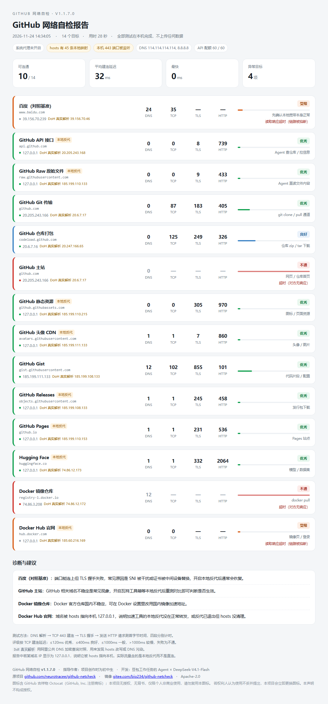

同一个数据还会在控制台打一份纯文本，跑完直接把报告甩进浏览器：

```text
  网络连通性自检 v1.1.0.1   GitHub / Hugging Face / Docker
  （下面这段是 1.1.0.1 时的真实输出，当时还叫「网络连通性自检」；1.1.0.3 起同名位置显示为「GitHub 网络自检」）
  ---------------------------------------------------------
  作者：项目创作时为初中生 · 开发：豆包工作任务的 Agent × DeepSeek-V4.1-Flash
  开源协议 Apache-2.0 · 原项目 https://github.com/neurotracee/github-netcheck
  系统代理：未开启（直连模式）
  hosts 记录：发现 45 条本地映射（可能来自瓦特工具箱等加速工具）
  本机 443 端口：有程序在监听（本地反代很可能在运行）

  [1/11] 百度（对照基准）  (www.baidu.com)   优秀   TCP 32ms / TLS 64ms / HTTP 150ms
  [2/11] GitHub API 接口  (api.github.com)   优秀   TCP 0ms / TLS 10ms / HTTP 1297ms
  [3/11] GitHub Raw 原始文件  (raw.githubusercontent.com)   优秀   TCP 0ms / TLS 12ms / HTTP 525ms
  [4/11] GitHub Git 传输  (github.com)   优秀   TCP 0ms / TLS 9ms / HTTP 810ms
  [5/11] GitHub 仓库打包  (codeload.github.com)   受限   TCP 103ms，但握手失败：读取响应超时（链路被掐断）
  [6/11] GitHub 主站  (github.com)   优秀   TCP 0ms / TLS 1ms / HTTP 786ms
  [7/11] GitHub 静态资源  (github.githubassets.com)   优秀   TCP 0ms / TLS 7ms / HTTP 1028ms
  [8/11] GitHub 头像 CDN  (avatars.githubusercontent.com)   优秀   TCP 0ms / TLS 9ms / HTTP 471ms
  [9/11] GitHub Gist  (gist.githubusercontent.com)   较慢   TCP 1141ms / TLS 280ms / HTTP 141ms
  [10/11] GitHub Releases  (objects.githubusercontent.com)   优秀   TCP 0ms / TLS 10ms / HTTP 550ms
  [11/11] GitHub Pages  (github.io)   优秀   TCP 0ms / TLS 9ms / HTTP 309ms

  ---------------------------------------------------------
  可连通 10 / 11    平均建连 117 ms    耗时 21 秒
  API 配额 56 / 60
  最快：GitHub 静态资源  0 ms
  最慢：GitHub Gist  1141 ms
  不通：GitHub 仓库打包

  报告已生成：reports\netcheck-20261114-193319.html
```

那个「TCP 0ms」不是作弊：本机反代把连接在本地就接住了，所以建连几乎不耗时——恰恰说明流量没真正走远。
`codeload` 那条「能连上但握手失败」才是这类工具最该报出来的状态：TCP 通了，TLS 被掐，下载仓库 zip 就会失败。

## 和瓦特工具箱是什么关系

瓦特工具箱（Watt Toolkit，原名 Steam++）的加速思路是：

```
hosts 把域名指向 127.0.0.1
      ↓
本机跑一个 YARP 反向代理（监听 80/443）
      ↓
反代用自己的线路去连真实服务器
      ↓
浏览器以为在直连，实际走的是本机反代（中间人，靠自签根证书解密）
```

这个工具的定位不一样：**它不代理，只测量**。
所以最实用的用法是——加速器关着跑一次，开着再跑一次，两份报告对比，立刻就能看出加速到底有没有生效、哪个域名还在掉。

需要注意两种模式的差异：

- **hosts 模式**：域名解析到 127.0.0.1，报告里的 IP 会显示 127.0.0.1，测到的延迟其实是「你到本地反代」的延迟，不代表到真实服务器的速度
- **系统代理模式**：本工具用原生 socket 直连，不走系统代理，所以测到的仍是真实直连状况——正好可以用来判断「如果不加速会有多惨」
- **安卓端的 VPN 模式**（Clash 类工具）：VPN 在系统层接管流量，socket 无法绕过，这时测到的就是「走规则后的结果」。报告顶部会标「VPN 已启用」，看数值时请把这层算进去

## 版本号与更新检查（只发一端时，另一端不会被误报）

版本号是四段 `主.次.修订.补丁`，例如 `1.1.3.2`：

- 只改文案、修小 bug → 只动**第四段**（`1.1.0.3` → `1.1.0.4`）；
- 加了新功能 → 动**第三段**（`1.1.1.x` → `1.1.3.2`）；
- 前两段基本不动，动了就是大版本，别轻易用。

仓库根目录有一份 `version.json`，**按平台分开写版本号**：

```json
{
  "android": { "version": "1.1.3.2", "url": "https://github.com/neurotracee/github-netcheck/releases" },
  "windows": { "version": "1.1.3.2", "url": "https://github.com/neurotracee/github-netcheck/releases" }
}
```

两端的「检查更新」都先读这个文件，**只认自己那一段**：只发 Windows 更新、把 `windows.version` 改成 `1.1.0.4`，
安卓端读到的仍是 `1.1.3.2`，就不会莫名弹出「有新版本」；反过来也一样。
这修掉了以前「发一次 Release，两端都提示更新但只有一端真变了」的逻辑 bug。
读不到 `version.json` 时才会退回读 Release（发布版本）的 tag，所以老环境也不会瞎。

**更新源默认 Gitee**：两端都只在「界面语言不是中文」且「系统时区不是 UTC+8」同时成立时（明确迹象说明大概率不在中国大陆），
才默认改走 GitHub；任何一条判断不出来（中文界面 / 时区 +8 / 读不到）一律走 Gitee。
用户可在设置里手动锁定「只用 Gitee」或「只用 GitHub」；选中的源连不上会自动换另一个再试一次。

**检查更新的规矩（两端一致）**：

- **什么时候查**：只在启动时查一次，没有定时轮询，也没有后台常驻进程；关掉「自动检查更新」就完全不联网。
- **查什么**：只 GET 两份公开内容——`version.json`（版本号），以及**仅在真有新版本时才多读一次**的发布列表（用来显示更新说明）。
  UA 里只带自己的版本号，不上传任何本地内容。
- **怎么算「有新版本」**：版本号统一按四段补零比较（`1.1.3` 与 `1.1.3.0` 视为同一版）；只认自己平台那一段，
  **某一版只给另一端发过包时，对本平台等于没有更新**——这就是不会误报的根本原因。
- **弹窗里能直接读到这一版改了什么**：不再是干巴巴一句「发现新版本」，而是把发布页正文里的摘要和
  按 Windows / 安卓 分条的条目直接显示出来，说明太长方框内可上下滚动。
  **落后好几个版本时**（例如停在 1.1.2.0，仓库已有 1.1.4.0、1.1.5.0）：变成一页一版的说明浏览器，
  最多列最近 4 版，左右翻看更早 / 更新的说明；**但下载目标永远是那一版最新的**，
  绿框里也写明了「翻页只换说明，不改变要装的版本」。
- **发现之后**：弹一次提示，默认在**应用内直接下载并安装**（下完核对包名与版本号，再交给系统安装器，不经过浏览器）；
  另留「用浏览器下载 / 复制链接」作为退路。点「以后再说」下次启动还会再提醒
  （故意不做「跳过此版本」的永久记忆，否则容易再也想不起来更新）。
- **下载地址只认自家域名**：`github.com`、`objects.githubusercontent.com`、`release-assets.githubusercontent.com`、
  `codeload.github.com`、`gitee.com`，而且必须是 https；不在这份名单里就只给发布页，不给直链。
- **不更新照样能用**：代码里没有任何「不更新就不给用」的逻辑；覆盖安装即可，设置与历史报告都保留。

## 怎么用

### 方式一：Windows，双击就跑

1. 到 **[Releases 页面](https://github.com/neurotracee/github-netcheck/releases/latest)** 下载 `NetCheck-Windows.zip`（或直接下载仓库里 `windows/` 目录的两个文件；国内网络慢可以去 [Gitee 发布页](https://gitee.com/bio234/github-netcheck/releases/latest)，两边是同一个包）。
2. 解压，双击 **一键网络自检.bat**，会出现一个菜单：

   ```
   [1] 开始自检（14 个点位，约 30 秒）
   [2] 只测 GitHub 系（更快）
   [3] 关于与开源信息
   [4] 设置（报告位置 / 先问我 / 自动打开 / 自动查更新 / 超时）
   [5] 检查更新（只读远端版本号）
   [0] 退出
   ```

   菜单顶部常驻署名、协议与两个项目地址——这个工具是谁做的、从哪儿来的，直接摆在最显眼的地方。
3. 选 1（或 2），逐个测试 14 个目标，大约 15～40 秒（看网络差到什么程度）。
4. 测完**不会闷头生成一堆文件**，而是先问三句：
   - 「这次要生成 HTML 报告吗？」（回车 = 是）
   - 「要现在用浏览器打开吗？」（回车 = 是）
   - 「记住这次的选择吗（下次不再问）？」（默认不记）

   答「记住」就把这次的选择写进 `settings.json`，之后不再打扰；想改回来，进「设置」勾上「每次自检结束后先问我」即可。
   报告存到 `reports\`（`latest.html` 是最新一份，历史按时间戳各存一份 HTML + CSV）。

不需要安装 PowerShell 模块、不需要 Python、不需要联网安装任何东西——用的是 Windows 自带的 PowerShell 5.1。
如果系统提示「无法加载文件，因为在此系统上禁止运行脚本」，用 bat 启动即可（bat 里已经带了 `-ExecutionPolicy Bypass`）。

### 方式二：安卓，装 APK

1. 到 **[Releases 页面](https://github.com/neurotracee/github-netcheck/releases/latest)** 下载 `NetCheck-<版本号>.apk`（Android 8.0 及以上，通用包，不挑 CPU 架构）。
2. 点开安装；系统提示「未知来源」时，允许当前文件管理器安装即可。
3. 打开应用，点 **开始自检**。测的过程中能看到「正在测试 3 / 14 · GitHub API 接口」。
4. 测完：每行可点开看细节（状态码、DoH 对照、四段耗时）；点 **导出报告** 把 HTML 交给你（见下面的保存位置说明），点 **分享 CSV** 导出原始数据。
5. 右上角 **齿轮** 进设置：界面语言（中文 / English）、外观（跟随系统 / 浅色 / 深色）、
   报告保存位置、更新检查方式、更新源（自动默认 Gitee / 只用 Gitee / 只用 GitHub）、版本与更新；最下面是 **关于与开源信息**
   （署名、协议、两个地址、隐私说明、二次开发三条硬要求）。

**报告保存位置**：默认走系统分享面板（发微信、发邮件、存到「文件」都行）；在设置里选了一个文件夹之后，
导出就直接写进那个文件夹，不再弹分享面板。

权限三个，都只服务于测量与更新本身：`INTERNET`（发起 socket 连接）、`ACCESS_NETWORK_STATE`（读当前网络类型、代理、私有 DNS、DNS 服务器）、
`REQUEST_INSTALL_PACKAGES`（更新时把下好的 APK 交给系统安装器，系统会再确认一次）。
没有存储权限——报告写在应用私有目录，导出时由你指定落地位置（SAF 授权，只给那一个目录）。
不做任何统计埋点，不上传任何数据；联网只有两处：自检本身，以及更新检查（只读一个公开版本号，
默认启动时静默查一次，可在设置里改成纯手动）。

### 方式三：从源码跑 Windows 端

```powershell
powershell -ExecutionPolicy Bypass -File .\windows\netcheck.ps1
```

进阶用法：

```powershell
# 只测 GitHub 系（快一些）
powershell -ExecutionPolicy Bypass -File .\windows\netcheck.ps1 -Quick

# 测完不询问、不打开浏览器，只按记住的「要不要报告」执行（给自动化/CI 用）
powershell -ExecutionPolicy Bypass -File .\windows\netcheck.ps1 -NoBrowser

# 只弹「关于与开源信息」窗口
powershell -ExecutionPolicy Bypass -File .\windows\netcheck.ps1 -About

# 只弹设置窗口（报告存哪、要不要先问我、自动打开、自动查更新、单段超时）
powershell -ExecutionPolicy Bypass -File .\windows\netcheck.ps1 -Settings

# 只查一次最新版本号，不测网络
powershell -ExecutionPolicy Bypass -File .\windows\netcheck.ps1 -CheckUpdate
```

设置写在脚本同目录的 `settings.json`（不写注册表、不联网），删掉它就恢复默认：

```json
{
  "ReportDir": "reports",
  "AutoOpen": false,
  "TimeoutMs": 3000,
  "AutoCheckUpdate": true,
  "AskBeforeReport": true,
  "SaveReport": true
}
```

`AskBeforeReport` 是「每次自检结束后先问我」；`AutoOpen` / `SaveReport` 只在关掉询问时生效；
`AutoCheckUpdate` 是启动时静默查一次版本号（只读公开文件，连不上就跳过）。

想换测试目标，用记事本打开 `windows/netcheck.ps1`，改开头 `$Targets` 那段，照着格式加一行就行：

```powershell
@{ Name = '某个站点'; Host = 'example.com'; Path = '/'; Desc = '备注' }
```

安卓端要改点位，改 `android/app/src/main/java/com/neurotracee/netcheck/net/Targets.kt` 的 `all` 列表，字段一一对应。

## 自己打包

Windows 端不需要打包：`.ps1` 是纯文本脚本，`bat` 只是个启动器。

安卓 APK：JDK 17 + Android SDK 34 + Gradle 8.7。

```bash
cd android
gradle assembleRelease
```

产物在 `android/app/build/outputs/apk/release/app-release.apk`。
签名配置读 `android/keystore.properties`（不入仓库），没有这个文件时会打出未签名的 release 包。
完整步骤、签名怎么生成、产物怎么核对，见 [docs/05-构建与发布.md](docs/05-构建与发布.md)。

## 已知限制

- **测的是 TCP/TLS 握手延迟，不等于下载速度。** 要测带宽得另外传大文件，本工具不做。
- **只测 IPv4、TLS 1.2。** 两端一致：安卓端强制 `TLSv1.2`，与桌面端 `SslProtocols::Tls12` 对齐，保证两台设备上的数值可比。
  代价是某些只支持 TLS 1.3 的站点会被判「受限」，目前 14 个点位里没有这种站点。
- **为了测纯网络连通性，证书校验被忽略。** 所以「证书链有问题但能连上」的情况，报告会显示正常。
- **超时统一 3 秒。** 网络特别差的时候，某些目标可能本来 5 秒能连上也被判失败——重跑一次看是否稳定即可。
- **安卓端拿不到的三项信息，用等价项替代**（这是两端报告唯一的结构性差异）：
  - 「本机 443 端口是否有程序在监听」→ 安卓不允许普通应用枚举端口，改为显示 **VPN 是否启用** 与 **私有 DNS 模式**；
  - 「系统代理」→ 安卓读的是 `ConnectivityManager` 的默认代理，不是 IE 那种注册表设置；
  - 「hosts 映射」→ 读 `/system/etc/hosts`，安卓上这个文件通常为空，读到几条就显示几条。
- **安卓 7 及以下不支持**（`minSdk 26`）。要用更低版本得自己改 `app/build.gradle.kts` 并处理 `privateDns` 相关的 API 差异。
- **每次运行都会在报告目录留一份 HTML 和 CSV**，觉得多了可以自己删（Windows 在 `reports/`，安卓在应用私有目录，卸载即清空）。

## 依赖与许可

| 依赖 | 版本 | 用途 | 许可 |
| --- | --- | --- | --- |
| Windows PowerShell（.NET Framework） | 系统自带 5.1+ | 脚本运行时 | 随 Windows 分发 |
| [AndroidX](https://developer.android.com/jetpack/androidx)（core-ktx / lifecycle / activity-compose） | 1.13.1 / 2.8.4 / 1.9.1 | 安卓基础框架 | Apache-2.0 |
| [Jetpack Compose](https://developer.android.com/jetpack/compose)（ui / foundation / material3 / material-icons-core） | BOM 2024.06.00 | 界面 | Apache-2.0 |
| [Kotlin 标准库](https://kotlinlang.org/) | 1.9.24 | 语言运行时 | Apache-2.0 |
| Android Gradle Plugin / Gradle | 8.4.2 / 8.7 | 构建（不进入产物） | Apache-2.0 |
| JUnit 4 / kotlin-test | 4.13.2 / 1.9.24 | 单元测试（不进入产物） | EPL-1.0 / Apache-2.0 |

**没有任何需要单独声明的第三方隐私/网络库**：探测内核是原生 `java.net.Socket` + `javax.net.ssl`，
界面是 Compose，HTTP 请求是手写的（就为了能分段计时）。所以 APK 里没有 OkHttp、没有统计 SDK、没有广告 SDK。
完整声明见 [NOTICE.md](NOTICE.md)。

## 隐私说明

- **不代理、不改系统设置、不写 hosts。** 全程只发起连接、只读响应头。
- **不联网上报任何东西。** 对外只发起这些连接：14 个测试点位本身、一次 DoH 对照查询（发往阿里公共 DNS）、
  以及安卓端启动时的一次更新检查（只读 Gitee 或 GitHub 上一个公开的版本号，不传本机任何信息，可在设置里关掉）。
- **报告不出本机。** Windows 端写在 `reports/`（或你在设置里指定的目录）；安卓端写在应用私有目录，只有你主动点「导出」才会离开应用。
- **报告里只包含**：点位名、域名、解析到的 IP、四段耗时、HTTP 状态码、评级。不含设备标识、不含账号、不含浏览记录。
- **安卓端不读通讯录、不读短信、不读相册、不要存储权限。**
- **Windows 端不用管理员权限、不写注册表**，设置只存在脚本同目录的 `settings.json`。
- 生成的 HTML 报告是**静态文件**，没有任何外链脚本或图片，断网也能打开。

## 许可

Apache License 2.0，见 [LICENSE](LICENSE)。
署名与出处要求（第 4 条与第 6 条的落地写法）见 [ADDITIONAL-TERMS.md](ADDITIONAL-TERMS.md)，第三方组件声明见 [NOTICE.md](NOTICE.md)。

```
Copyright (C) 2026 项目创作时为初中生

Licensed under the Apache License, Version 2.0 (the "License");
you may not use this file except in compliance with the License.
You may obtain a copy of the License at

    http://www.apache.org/licenses/LICENSE-2.0

Unless required by applicable law or agreed to in writing, software
distributed under the License is distributed on an "AS IS" BASIS,
WITHOUT WARRANTIES OR CONDITIONS OF ANY KIND, either express or implied.
See the License for the specific language governing permissions and
limitations under the License.
```

## 文档

| 想看什么 | 去哪 |
| --- | --- |
| 这一版更新了什么、修了什么 | [CHANGELOG.md](CHANGELOG.md) |
| 文档地图：哪个文件在哪、怎么找 | [DOCS.md](DOCS.md) |
| Windows / 安卓 完整操作说明 | [docs/01](docs/01-使用说明-Windows.md) · [docs/02](docs/02-使用说明-安卓.md) |
| 检测方法与判读标准 | [docs/03](docs/03-检测方法与判读标准.md) |
| 常见问题 | [docs/04](docs/04-常见问题.md) |
| 打包、测试、发版 | [docs/05](docs/05-构建与发布.md) |
| 怎么发 Release（网页一步步点） | [docs/06](docs/06-发布Release操作指南.md) |
| 想参与改进、提缺陷、加点位 | [CONTRIBUTING.md](CONTRIBUTING.md) |

安卓端没有单独的 README：两端的能力、许可、署名共用一套说法，写两份必然一头改了一头忘。

## 维护节奏与反馈

这个项目由个人在业余时间维护，取舍很直白：**测不准、判读误导、结果不稳定**这类问题优先处理；界面润色、锦上添花的功能可以慢慢来。代码全部公开，任何人不经询问就可以 fork 自行改进，不必等作者回复。

- **报缺陷**：到 [Issues](https://github.com/neurotracee/github-netcheck/issues/new/choose) 按模板填，写清版本号、系统/机型、哪几个点位、报告截图。两端 Issues 都开着，Gitee 那边也行（[Gitee Issues](https://gitee.com/bio234/github-netcheck/issues)）。
- **提改进 / 提代码**：先看 [CONTRIBUTING.md](CONTRIBUTING.md)，里面有目录结构、怎么跑自检、以及提交时会被要求做什么。
- **回复可能不快**：看到了会处理，没回不代表没看见，也不代表被否掉。

## 赞赏

如果这个项目帮你省了时间，可以请我喝杯奶茶 🧋


> **这张图在 GitHub 页面上显示不出来？** 不是你操作错了，也不是图片删了。README 里的仓库内图片在 GitHub 页面上走
> `raw.githubusercontent.com`，这个域名在国内常被掐断——本工具测的正是这个点位。到 Gitee 仓库的同一页看就有图：
> https://gitee.com/bio234/github-netcheck （文末「赞赏」一节）。两端程序里的二维码是**内置图片**，不依赖网络，
> 断网也能看：Windows 端「关于与开源信息」窗口、安卓端「关于」页最下面的「赞赏（完全自愿）」卡片。

程序里也能直接看到这张码：Windows 端「关于与开源信息」窗口、安卓端「关于」页的「赞赏（完全自愿）」卡片，
文案是同一句——**要是这个小工具帮你省了点时间，愿意的话可以请我喝杯奶茶；不打赏也一模一样用，功能一个都不少。**

> **点 Star 比打赏更有用。** 两个都点一下最实在：GitHub 那颗让国外和搜索引擎找到它，Gitee 那颗让不翻墙的人也打得开；
> 只点一边，另一半人就搜不到——差一颗星，少一半人。不方便的话点一个就够，功能一个不少。
> 直达：[GitHub Star（标星）](https://github.com/neurotracee/github-netcheck) ｜ [Gitee Star（收藏）](https://gitee.com/bio234/github-netcheck)
>
> 国内用户也可以扫码请我喝杯奶茶——完全自愿，不打赏一样免费、功能不缺。

---

# NetCheck — GitHub Network Self-Check

[](https://github.com/neurotracee/github-netcheck/blob/main/LICENSE)
[](https://github.com/neurotracee/github-netcheck/releases/latest)
[](https://github.com/neurotracee/github-netcheck/releases)
[](https://gitee.com/bio234/github-netcheck)
[](https://github.com/neurotracee/github-netcheck/actions/workflows/ci.yml)

**English** | [中文](#github-网络自检)

> **This project has the same origin and the same author as the PDF Privacy Masker tool.** The GitHub repository was created first; Gitee is the mainland-China mirror maintained by the same developer
> (https://gitee.com/bio234/github-netcheck). Both sides carry identical content — neither is a copy of the other.
>
> The author's other project: **PDF Privacy Masker** (local, offline redaction of PDFs, files never leave your machine) —
> GitHub: https://github.com/neurotracee/pdf-privacy-masker
>
> Gitee: https://gitee.com/bio234/pdf-privacy-masker
>
> That project is under AGPL-3.0, this one under Apache-2.0. The licences differ; do not mix them.

A purely local, zero-dependency connectivity probe that watches one thing: **whether mainland China can reach GitHub-family services**. **It does not proxy, does not accelerate, does not touch hosts — it only measures.**

<p align="center">
  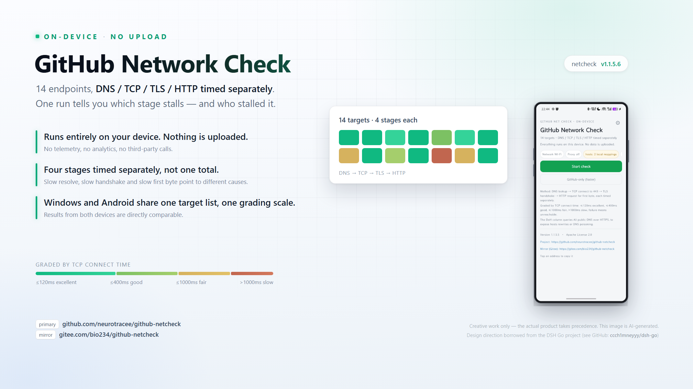
</p>
<p align="center">
  <sub>↑ Hero artwork: the composition, colours and copy are designed; the two panels are a real Windows console capture and a real-device Android capture, with the UI content untouched.<br>
  The two small lines in its bottom-right corner (“Creative work only, the actual UI prevails; this image is AI-generated” and “Design direction borrowed from the DSH Go project, see GitHub: ccch1mneyyy/dsh-go”) belong to that artwork and say nothing about what the UI looks like — the real UI is in the interface section below.</sub>
</p>

> **Created on 14 November 2026.** The Windows script, the Android APK and both repositories (GitHub `neurotracee/github-netcheck`, Gitee `bio234/github-netcheck`) were all finished the same day.

> **About the name.** This project used to be called "网络连通性自检" (generic network self-check), which read like yet another bandwidth tester. What it actually diagnoses is GitHub — Pages, raw, API, object storage, clone and download — plus development resources that commonly stall, such as Hugging Face and Docker. So from 1.1.0.3 both builds were renamed **GitHub 网络自检** (GitHub Network Self-Check), and the repository went from `netcheck` to **`github-netcheck`** (renamed on GitHub and Gitee together; old links redirect to the new address) — otherwise the repository name would still only say "network check". The package name `com.neurotracee.netcheck` and the script name `netcheck.ps1` were deliberately left alone: changing the package name would break in-place upgrades of the version already installed on phones.

**Keywords (tags for search)** — kept in Chinese because that is what local search engines index: GitHub 连不上 排查 · GitHub 加速检测 · GitHub Pages 打不开 · raw.githubusercontent 加载失败 · 网络连通性自检 · 连通性检测 · DNS 解析 / TCP 建连 / TLS 握手 / HTTP 首字节（四段分别计时）· 延迟测试 · hosts 映射检查 · 系统代理检查 · Hugging Face 下载慢 · Docker 拉取失败 · 国内网络环境 · Android APK · PowerShell 脚本 · Kotlin / Jetpack Compose · Apache-2.0 · 零第三方依赖

It walks through the 14 targets that usually stall, splitting each one into **DNS resolve → TCP connect → TLS handshake → HTTP time-to-first-byte**, four stages timed separately, then writes an HTML report. One glance tells you whether the problem is "cannot resolve", "cannot connect", "connects but the handshake is cut", or "the link works but is slow".

The Windows build is a PowerShell script you double-click — nothing to install. The Android build is an APK — one tap to start.
**Both share the same target list, the same grading thresholds and the same report layout**, so a phone report and a desktop report can be compared side by side.

---

## Interface

<h3 align="center">Screens on both platforms</h3>

<p align="center">
  Every screenshot below is a real-device capture — no collages, no mockups. The wording you see on screen is exactly the wording the program is using.<br>
  The Android UI ships with a built-in Chinese/English switch (“Settings → Language”, defaults to the system language); the Windows build is Chinese-only for now. This section shows the English UI; the Chinese UI screenshots are in the Chinese section at the top of this README.
</p>

<h3 align="center">Android: one run, every verdict at a glance</h3>
<p align="center">Main · Result · History · History detail. All 14 endpoints report DNS / TCP / TLS / HTTP timings, issues are listed first, and every run can be revisited in history.</p>

<p align="center">
  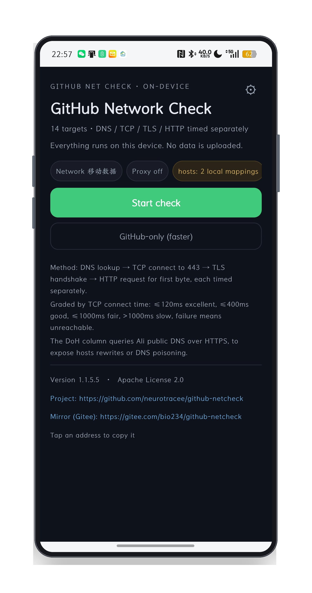
  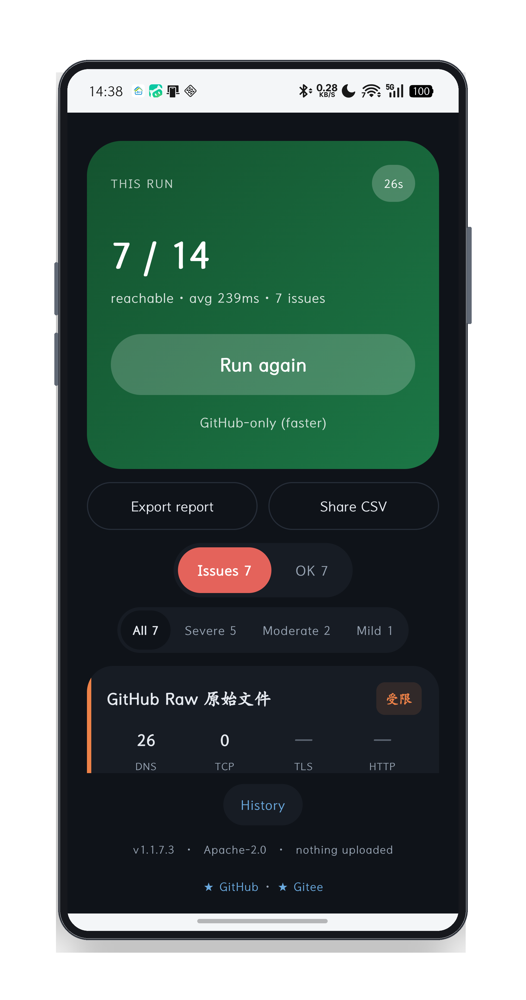
  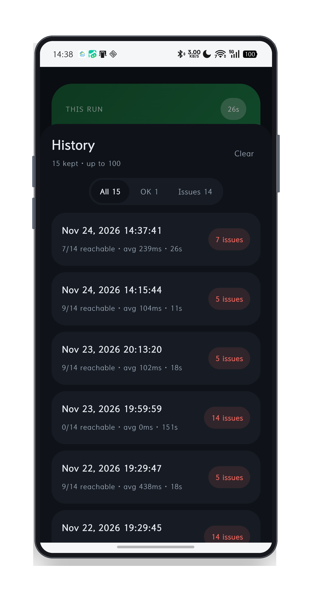
  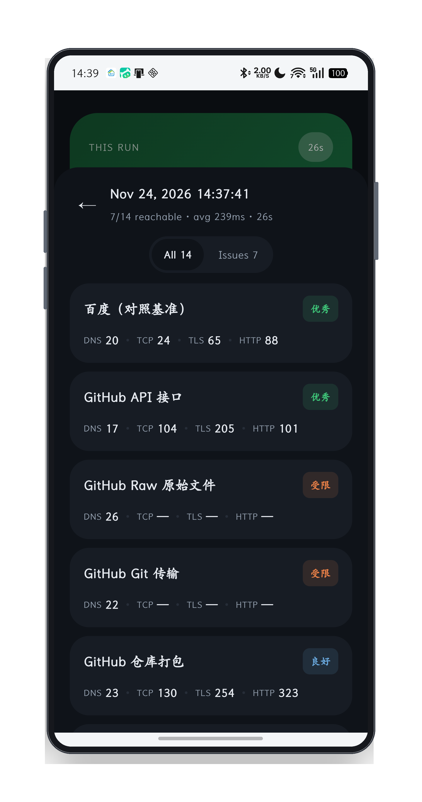
</p>
<p align="center">
  <sub>↑ These four are the English dark-theme set. The Chinese set at the top of this README is the light-theme set. That is only a division of labour between the two languages — the same four screens do not need to be published twice — and it says nothing about which language deserves which theme: both themes and both languages are selectable, independently, by everyone, in the app.<br>
  The two “中途停止 · 已测 5/14” rows in the history shot are real: the stop button was actually pressed while taking these screenshots.</sub>
</p>

<br>

<h3 align="center">Windows: the console is the program</h3>
<p align="center">Double-click “一键网络自检.bat” and <strong>this menu is the first thing you get</strong>: type a number to pick a function — 1 runs the check, 3 opens the About window, 4 opens Settings, 5 only checks for updates, 0 quits.<br>
Nothing runs until you press 1; that is the second image below. The two dialogs are shells only — the main interface is the console, from start to finish.</p>

<p align="center">
  
</p>
<p align="center">
  <sub>↑ before running: this is what you see right after launch — title, author and both repository URLs at the top, and “请选择:” waiting for a number</sub>
</p>

<p align="center">
  
</p>
<p align="center">
  <sub>↑ after running: choice 1, all 14 endpoints. Those two long lines are raw connection-failure exceptions, left unedited</sub><br>
  
  <br><sub>↑ the “About and open-source information” window from choice 3 — not the main interface</sub>
</p>

<br>

| Screen | What is on it |
| --- | --- |
| Android · Main | Title row + endpoint-count pill + gear entry; the main card shows the current state and a “Start check” button; two info cards below describe the current network and local hosts |
| Android · Result | Summary card + “Export report / Share CSV”; issues are listed by default, and the “Issues / OK” pair at the top can be tapped or swiped, with issues further split into “severe / moderate / mild” |
| Android · History | The “All / OK / Issues” row filters by run count, and issues are split into three grades again; each row states its time and result, and interrupted runs are marked “Incomplete” |
| Android · History detail | One run, with four-stage timings per endpoint, switchable between “All / Issues” |
| Android · Settings | Language / appearance / report location / update-check mode / update source (auto, Gitee defaults — Gitee only / GitHub only) / version and update check / About entry |
| Android · About | Guiding author, development (Doubao work-task Agent × DeepSeek-V4.1-Flash), licence, both URLs, privacy, the three hard requirements, test method, maintenance rhythm |
| Windows · Menu (entry) | Appears the moment the .bat is double-clicked: title block + author / development / licence / both URLs + items `[1]`–`[5]` + `[0]` quit + “请选择:” |
| Windows · Console (result of 1) | All 14 endpoints with DNS / TCP / TLS / HTTP timings, ending with “reachable X/14, average connect time, elapsed, fastest / slowest / dead” |
| Windows · About window | Opened by 3: the same “about and open-source” text, plus the donation QR code and direct Star buttons for both repositories |

> The Android screenshots were retaken on a real device running v1.1.6.0 (20 November): four in Chinese (light) and four in English (dark). The one-light-one-dark split is only a division of labour between the two languages, not a statement that one language gets one theme — language and theme are separate settings for everyone. The same reasoning is repeated in the Chinese section.
> The Settings and About screenshots are still the older ones (the features did not change, but the About page still shows 1.1.5.5 and lacks the “test method” paragraph added later); they will be retaken.
> The About window shot was retaken for v1.1.5.2; the console menu shot is also from v1.1.5.2, captured as it appears when you double-click the .bat.
> Framing scripts: phones use `docs/tools/frame_ui.py` (device shell; batch version `frame_batch.py`), Windows uses `docs/tools/frame_window.py` (window shell). Re-running one command after replacing a screenshot is enough — no manual image editing.
> Endpoint names stay in Chinese inside the English screenshots on purpose: switching the app language changes the UI chrome and the interface copy, while the target names come from the shared target list and stay as they are (the Settings screen says so).
> **The three Windows screenshots are shared by both language sections**, because the Windows build currently has a Chinese-only interface — there is no English Windows UI to photograph.

---

## Download (start here)

**Current versions: Android v1.1.6.1 ・ Windows v1.1.5.2**. Both platforms carry the same content; pick whichever opens for you (with slow mainland connectivity, prefer Gitee).

| What you want | GitHub | Gitee (mainland mirror) |
| --- | --- | --- |
| Latest release page | https://github.com/neurotracee/github-netcheck/releases/latest | https://gitee.com/bio234/github-netcheck/releases/latest |
| Android APK | https://github.com/neurotracee/github-netcheck/releases/download/v1.1.6.1/NetCheck-1.1.6.1.apk | https://gitee.com/bio234/github-netcheck/releases/download/v1.1.6.1/NetCheck-1.1.6.1.apk |
| Windows package (zip) | https://github.com/neurotracee/github-netcheck/releases/download/v1.1.5.2/NetCheck-Windows.zip | https://gitee.com/bio234/github-netcheck/releases/download/v1.1.5.2/NetCheck-Windows.zip |
| Repository home | https://github.com/neurotracee/github-netcheck | https://gitee.com/bio234/github-netcheck |

Unzip the Windows package and double-click **一键网络自检.bat**; install the APK directly (the system will warn about an “unknown source” — the reason is in the next section).
SHA-256 checksums are in the [release notes](https://github.com/neurotracee/github-netcheck/releases/latest); after downloading you can verify them yourself with `certutil -hashfile <filename> SHA256`.

> **Did your Gitee APK download arrive as .zip? The file is not corrupt.** Gitee's download server sniffs the file header and serves APKs as `application/zip`;
> some mobile browsers (Edge mobile, for instance) then rename the file to `.zip`. Rename it back to `.apk` and it installs normally — the bytes are identical.
> If that is annoying, simply take the APK from the GitHub release page (it is served as `application/vnd.android.package-archive` and is never renamed).

### Where older releases live (Gitee has limited capacity)

Gitee's total attachment quota is only 1 GB, which cannot hold every historical build, so the installers are kept in three tiers on both platforms — **Windows and Android are treated exactly the same**:

| Tier | GitHub | Gitee (mainland mirror) |
| --- | --- | --- |
| **Latest** (Android v1.1.6.1 APK, Windows v1.1.5.2 zip) | attachments kept | **attachments kept** |
| **Previous** (Android v1.1.6.0 APK, Windows v1.1.5.1 zip) | attachments kept | attachments kept (for in-place upgrades in transition) |
| **Anything older** | every attachment kept | **attachments removed**, release notes only |

In other words: **the latest and the previous Windows and Android packages can both be downloaded from Gitee**; only older versions have to be fetched from the GitHub release page.
Older releases: https://github.com/neurotracee/github-netcheck/releases (the corresponding Gitee release notes also say “older versions: download from GitHub” and link there).

**Found it useful? Just go — no payment needed.** The most practical help is one click on both: the GitHub star lets people abroad and search engines find it, the Gitee star lets people who cannot reach GitHub still find it. Star only one and half the audience never sees it — one star missing, half the audience gone. If that is inconvenient, one is enough.
[GitHub Star](https://github.com/neurotracee/github-netcheck) ｜ [Gitee Star](https://gitee.com/bio234/github-netcheck)
If this little tool saved you some time and you feel like buying me a milk tea, the “赞赏 / Donations” section at the end has a WeChat QR code — **entirely voluntary; nothing is missing if you do not donate**.

**Version numbering.** Versions have four parts (major.minor.revision.patch); small text changes and small fixes bump only the last part. So 1.1.2.0 → 1.1.3.2 was a feature-level update (donation entry + update prompt on launch),
while 1.1.3.2 → 1.1.3.2 was a **pure wording update**: the statement “the icon contains GitHub's Octocat, this project has no authorisation or endorsement, personal non-commercial use only, do not reuse the icon” was
written into both programs (About page, console, report footer), with not a single line of functionality touched.

## Three things to know before installing

**① Why it is only on Releases and not in an app store.**
The author is a minor. Developer registration in the Huawei / Xiaomi / OPPO / vivo app markets requires mutual certification: photographing an ID card in hand plus binding **a real-name bank card in the author's own name**.
The author cannot get a real-name bank card (minors cannot open one), and the family does not understand the “upload your ID card and bank card” process and is highly wary of being scammed, so this route is closed — not out of laziness. The APK therefore sits directly in GitHub / Gitee Releases, signed with the author's own certificate; the system will warn about an “unknown source” — **that is the inevitable result of not going through a store, not a problem with the app itself**.

**② What is that “information may be collected by third parties” warning during installation?**
It is the standard risk warning Android (especially vendor ROM installers) shows for **any APK that does not come from an app store**. It is addressed to everyone, is not aimed at this app, and does not mean this app collects anything. This app requests only three permissions (`INTERNET`, `ACCESS_NETWORK_STATE`,
`REQUEST_INSTALL_PACKAGES` — the last one only hands a downloaded package to the system installer on update, and the system asks once more whether to install), with no storage, location, contacts, SMS or camera permissions, and no analytics / advertising / crash-reporting SDK (verify it yourself against
[AndroidManifest.xml](android/app/src/main/AndroidManifest.xml) and [NOTICE.md](NOTICE.md)).
The signing certificate fingerprint is published in the release notes, so you can check it yourself.

**About the signature itself** (since 1.1.0.3): the APK is signed with **APK Signature Scheme v2 + v3** (v2 for Android 7–8, v3 for 9 and above, which is sturdier than v2 alone because some vendor ROM installers check v3 strictly). The certificate is self-signed, DN
`CN=NetCheck, OU=OpenSource, O=neurotracee, L=Datong, ST=Shanxi, C=CN`,
SHA-256 fingerprint `c43205775efaf5d088b646d6999e81e08213c43969b3140b541c29d0c7bb8b5a` — check it yourself with:

```text
apksigner verify -v --print-certs NetCheck-<version>.apk
```

A self-signed certificate only means “no commercial CA vouches for it”; it does not mean insecure; **it is not a passport for app stores, and it does not affect in-place upgrades**.
The same key has been used from 1.0.0.0 through 1.1.0.3, so older builds can be installed over it without uninstalling.

**③ What exactly does it connect to?**
The only network permission is `INTERNET`, used for three things: **an automatic update check at launch (can be switched off in settings)**,
**a manual “check for updates”**, and **timing those 14 endpoints**.
The update check reaches **two repositories only** — Gitee in mainland China (https://gitee.com/bio234/github-netcheck) and GitHub abroad
(https://github.com/neurotracee/github-netcheck) — the script picks whichever is reachable and reads one public line with the version number.
**Nothing is uploaded: no files, no accounts, no device identifiers**; when timing latency it only opens connections and reads one response header, never sending content.


---

## Who made this project

- **Guiding author: a middle-school student at the time of the project's creation.** They are responsible for exactly three things: stating the requirements, deciding which endpoints to keep and what the grading criteria are, and accepting or rejecting the result and filing feedback. They do not write code.
- **Development: the Doubao work-task Agent × DeepSeek-V4.1-Flash.** All of the construction — both clients' code, builds, signing, creating the repositories and publishing — was done by the Agent under their repeated requirements and feedback.
- **Terminology (do not confuse these):** **the Agent is provided by the Doubao work task**, and **the model is DeepSeek's (V4.1-Flash, chosen by the guiding author in their own client)**. So this is not “Doubao's model” and not a Tencent product — it has nothing to do with Tencent.
- **Licence: Apache License 2.0.** See [LICENSE](LICENSE); attribution and source requirements are in [ADDITIONAL-TERMS.md](ADDITIONAL-TERMS.md) and [NOTICE.md](NOTICE.md).
- **Maintenance:** maintained in personal spare time, all code public, anyone may fork and improve it without asking. Rhythm and feedback channels: the “[Maintenance and feedback](#maintenance-and-feedback)” section at the end.

## About attribution (read this before forking or commercial use)

This project **permits commercial use, permits derivative work, permits closed-source distribution** (Apache-2.0 is not copyleft and carries no forced-open-source infection),
with no fee, no application, no need to wait for the author's approval (the author checks the project roughly once every month or two, so replies can be slow).

But the **three requirements below are hard**, under Apache-2.0 §4 (b)(c)(d) and §6 (trademarks); details in [ADDITIONAL-TERMS.md](ADDITIONAL-TERMS.md):

### ① Keep the author attribution

Keep these two lines, verbatim, and do not replace them with someone else's name:

```
指导作者：项目创作时为初中生
由 豆包工作任务的 Agent × DeepSeek-V4.1-Flash 开发
```

(Guiding author: a middle-school student at the time of creation / Developed by the Doubao work-task Agent × DeepSeek-V4.1-Flash.)

Under Apache-2.0 §4 (c): copyright, patent, trademark and attribution notices in the source must be retained.

### ② Show the original project URL inside the program

```
https://github.com/neurotracee/github-netcheck
https://gitee.com/bio234/github-netcheck      # mirror / 镜像（国内访问更快）
```

**Users must be able to see it** — the About window, the home-screen footer, a help menu, the report footer, or `--about` output: any one of these is enough.
Writing it only in the `LICENSE` file or in a source comment hundreds of lines away **does not count**, because users never see it in normal operation.

How this project does it (safe to copy):

| Where | What |
| --- | --- |
| Android home footer | `原项目地址：https://github.com/neurotracee/github-netcheck` + `镜像（Gitee）：gitee.com/bio234/github-netcheck` (two tappable lines that copy on tap) |
| Generated HTML report | the same two URL lines in the report footer |
| Windows build | first lines of the console, and the first screen of the documentation |

### ③ Modified versions must say they were modified

If you are not redistributing the original verbatim, state prominently inside the program:

> This program is based on https://github.com/neurotracee/github-netcheck
> (mirror: https://gitee.com/bio234/github-netcheck) and has been modified; it is not published by the original author.

Under Apache-2.0 §4 (b): modified files must carry a prominent “modified” notice.

The point is that nobody should mistake your changed version for the original author's release — especially if your version has bugs, privacy risks, or starts charging money.

### Apache-2.0 itself also requires

- **Ship the licence and NOTICE with distributions**: when distributing the APK or the script, include `LICENSE` and `NOTICE.md` (§4 (a)(d)).
- **Keep the modification marks**: changed source files must say what changed (§4 (b)).
- **Do not use the author's name as endorsement**: you may not imply the original author vouches for your version (§6).
- **Change the name**: the program name “GitHub 网络自检 / NetCheck” and the icon are outside the licence grant (§6 trademark clause) —
  forks should rename and replace the icon so people are not misled.

Closed-source commercial use? **Apache-2.0 permits it**, but the attribution and source requirements above still apply.

### ④ Icon (important — this paragraph overrides any earlier wording about the icon)

**There is a GitHub cat in the icon.** In this project's icon (`assets/icon/` PNG and ICO files, plus the Windows and Android app icons), the
cat-head silhouette comes from GitHub's mascot **Octocat**. **Octocat® is a registered trademark of GitHub, Inc.** (GitHub, Inc. is now a Microsoft company),
and the design is also registered with the U.S. Copyright Office. Those rights **do not belong to this project's author**, and this project has **no authorisation, approval or endorsement from GitHub, Inc. or Microsoft**.

The word “GitHub” in the project name only describes **what this tool checks** (connectivity to GitHub services); it is a nominative use and implies no affiliation with GitHub.

| Boundary | What it means |
| --- | --- |
| **The project's own position** | **Personal, non-commercial use only.** The author does not sell it, does not publish it in app stores, grants no commercial licence, and earns nothing from it (donations are voluntary small support from readers and have nothing to do with licensing). **Commercial use of this project is prohibited.** |
| **Strongly advised: do not reuse this icon** | If you fork it, extend it, rename and publish it, or intend to use it in another project, **replace the icon with one containing no third-party trademark elements**. Do not keep it as is, and do not keep a modified version either. Using it on your own machine is unaffected. |
| **The rights holder may ask for removal** | If GitHub, Inc. or Microsoft considers this use inappropriate, filing an issue in the repository will lead to the icon being replaced and the related wording cleaned up immediately. |
| **This notice is not a shield** | The text above only states the author's position and the intended boundary. **It grants no licence, cannot substitute for the rights holder's permission, and does not exempt users from their own legal liability.** For commercial use or wide public distribution, obtain written permission from the rights holder first. |

---

## What it tests

Every target is measured in four stages, timed separately, so you can pin down exactly which step stalls:

| Stage | Meaning | What a failure means |
|---|---|---|
| DNS | time to resolve the domain | cannot resolve = DNS poisoning or no network |
| TCP | time to open a connection to port 443 | timeout = the port is unreachable, most likely blocked |
| TLS | time for the encrypted handshake | timeout / reset = SNI interference, classically “the site will not open but ping works” |
| HTTP | request sent to first byte received (TTFB) | timeout = the path is being cut |

### The 14 endpoints

| Group | Endpoint | What it is for |
|---|---|---|
| Baseline | Baidu `www.baidu.com` | first confirm the local broadband itself is fine |
| GitHub | API `api.github.com/rate_limit` | agents querying repositories and metadata; also reads the current quota |
| GitHub | Raw `raw.githubusercontent.com` | agents reading files directly out of a repository |
| GitHub | Git transport `github.com/.../info/refs` | the channel `git clone / pull` actually uses |
| GitHub | Archive download `codeload.github.com` | downloading a repository zip / tar |
| GitHub | Main site `github.com` | web pages / repository home |
| GitHub | Static assets `github.githubassets.com` | icons / page resources |
| GitHub | Avatar CDN `avatars.githubusercontent.com` | avatars / images |
| GitHub | Gist `gist.githubusercontent.com` | code snippets, configuration |
| GitHub | Releases `objects.githubusercontent.com` | release downloads |
| GitHub | Pages `github.io` | Pages sites |
| AI | Hugging Face `huggingface.co` | models / datasets |
| Container | Docker registry `registry-1.docker.io/v2/` | `docker pull` |
| Container | Docker Hub `hub.docker.com` | image pages / login |

The top of the report shows the **API quota** (60 requests/hour when unauthenticated) — watch that number when an agent keeps hitting rate limits.
“GitHub family only” skips Hugging Face and Docker, testing 11 endpoints and finishing 3–8 seconds sooner.

## How to read it

| Label | Criterion | Meaning |
|---|---|---|
| Excellent | connect ≤ 120 ms | as fast as domestic sites |
| Good | ≤ 400 ms | perfectly usable |
| Fair | ≤ 1000 ms | works, but stutters |
| Slow | > 1000 ms | practically unusable |
| Limited | TCP works, TLS fails | the classic “blocked” state |
| Dead | TCP does not even connect | fully blocked |

The **real DoH resolution** in the report: the domain's real IP is fetched over encrypted DNS from Ali public DNS and compared with what the machine resolved.
If the two differ, the local DNS has been rewritten or poisoned; if the local IP shows `127.0.0.1`, hosts has taken over the domain.

## What the output looks like

A real run looks like this (home broadband, 2026-11-14, full 14-endpoint mode): environment chips at the top (system proxy, hosts mappings,
local 443 listeners, DNS servers), four summary cards in the middle, then one card per endpoint — the vertical bar on the left is the grade colour, on the right
the DNS / TCP / TLS / HTTP milliseconds, and under the domain a line with the resolved IP and the DoH comparison.


The same data is also printed as plain text in the console, and the report is thrown into your browser when the run ends:

```text
  网络连通性自检 v1.1.0.1   GitHub / Hugging Face / Docker
  （下面这段是 1.1.0.1 时的真实输出，当时还叫「网络连通性自检」；1.1.0.3 起同名位置显示为「GitHub 网络自检」）
  ---------------------------------------------------------
  作者：项目创作时为初中生 · 开发：豆包工作任务的 Agent × DeepSeek-V4.1-Flash
  开源协议 Apache-2.0 · 原项目 https://github.com/neurotracee/github-netcheck
  系统代理：未开启（直连模式）
  hosts 记录：发现 45 条本地映射（可能来自瓦特工具箱等加速工具）
  本机 443 端口：有程序在监听（本地反代很可能在运行）

  [1/11] 百度（对照基准）  (www.baidu.com)   优秀   TCP 32ms / TLS 64ms / HTTP 150ms
  [2/11] GitHub API 接口  (api.github.com)   优秀   TCP 0ms / TLS 10ms / HTTP 1297ms
  [3/11] GitHub Raw 原始文件  (raw.githubusercontent.com)   优秀   TCP 0ms / TLS 12ms / HTTP 525ms
  [4/11] GitHub Git 传输  (github.com)   优秀   TCP 0ms / TLS 9ms / HTTP 810ms
  [5/11] GitHub 仓库打包  (codeload.github.com)   受限   TCP 103ms，但握手失败：读取响应超时（链路被掐断）
  [6/11] GitHub 主站  (github.com)   优秀   TCP 0ms / TLS 1ms / HTTP 786ms
  [7/11] GitHub 静态资源  (github.githubassets.com)   优秀   TCP 0ms / TLS 7ms / HTTP 1028ms
  [8/11] GitHub 头像 CDN  (avatars.githubusercontent.com)   优秀   TCP 0ms / TLS 9ms / HTTP 471ms
  [9/11] GitHub Gist  (gist.githubusercontent.com)   较慢   TCP 1141ms / TLS 280ms / HTTP 141ms
  [10/11] GitHub Releases  (objects.githubusercontent.com)   优秀   TCP 0ms / TLS 10ms / HTTP 550ms
  [11/11] GitHub Pages  (github.io)   优秀   TCP 0ms / TLS 9ms / HTTP 309ms

  ---------------------------------------------------------
  可连通 10 / 11    平均建连 117 ms    耗时 21 秒
  API 配额 56 / 60
  最快：GitHub 静态资源  0 ms
  最慢：GitHub Gist  1141 ms
  不通：GitHub 仓库打包

  报告已生成：reports\netcheck-20261114-193319.html
```

That “TCP 0ms” is not cheating: a local reverse proxy accepts the connection locally, so connecting costs almost nothing — which is exactly proof that the traffic never leaves the machine.
The `codeload` line — “connects, then the handshake fails” — is the state this kind of tool most needs to surface: TCP gets through, TLS is cut, and downloading a repository zip will fail.
(The sample above is a genuine early-version console log, so its labels are still Chinese; the Windows console is Chinese-only to this day, which is why the English README shows Chinese console output — the numbers mean the same thing.)

## How it relates to Watt Toolkit

Watt Toolkit (formerly Steam++) accelerates like this:

```
hosts points the domain at 127.0.0.1
      ↓
a local YARP reverse proxy runs (listening on 80/443)
      ↓
the proxy dials the real server over its own route
      ↓
the browser believes it is connecting directly, but actually hits the local proxy (a man in the middle, decrypting with a self-signed root CA)
```

This tool is positioned differently: **it does not proxy, it only measures**.
So the most practical habit is — run once with the accelerator off, run again with it on, compare the two reports, and you see immediately whether acceleration actually works and which domain is still dropping.

The two modes behave differently, and you must account for it:

- **hosts mode**: the domain resolves to 127.0.0.1, so the report shows 127.0.0.1 and the latency you measure is “you to the local proxy”, not the speed to the real server
- **system-proxy mode**: this tool dials with raw sockets and ignores the system proxy, so what you measure is still the true direct connection — exactly what you need to answer “how bad would it be without acceleration”
- **VPN mode on Android** (Clash-style tools): a VPN takes over traffic at the system layer, sockets cannot bypass it, so what you measure is the post-rules result. The top of the report flags “VPN enabled” — factor that in when reading the numbers

## Version numbering and update checks (publishing one platform never triggers a false alarm on the other)

Versions have four parts `major.minor.revision.patch`, e.g. `1.1.3.2`:

- wording-only changes and small bug fixes → bump the **fourth part** only (`1.1.0.3` → `1.1.0.4`);
- new features → bump the **third part** (`1.1.1.x` → `1.1.3.2`);
- the first two parts rarely move; moving them means a major release, do not use lightly.

The repository root holds a `version.json`, which **records a version per platform**:

```json
{
  "android": { "version": "1.1.3.2", "url": "https://github.com/neurotracee/github-netcheck/releases" },
  "windows": { "version": "1.1.3.2", "url": "https://github.com/neurotracee/github-netcheck/releases" }
}
```

Both builds read this file first and **only trust their own section**: if you publish a Windows update only and set `windows.version` to `1.1.0.4`,
the Android build still reads `1.1.3.2` and will not pop a spurious “new version available”; the reverse holds too.
This fixed the earlier logic bug where “one release made both platforms prompt, but only one had actually changed”.
Only when `version.json` cannot be read does it fall back to the release tag, so old environments still behave sensibly.

**The update source defaults to Gitee**: both builds switch to GitHub by default only when “the UI language is not Chinese” **and** “the system time zone is not UTC+8” hold at the same time (a clear sign the user is probably outside mainland China); if either check is inconclusive (Chinese UI / UTC+8 / cannot read), Gitee is used.
Users can pin “Gitee only” or “GitHub only” in settings; if the chosen source is unreachable it automatically retries the other one once.

**Update rules (identical on both platforms)**:

- **When**: once at launch only — no polling, no background resident process; switch off “check automatically” and it never touches the network.
- **What**: only GETs two public things — `version.json` (the version number), plus the release list **read one extra time only if a newer version really exists** (to show the update notes).
  The user agent carries nothing but its own version; no local content is uploaded.
- **What counts as “newer”**: versions are compared as four parts with zero padding (`1.1.3` and `1.1.3.0` are the same release); only your own platform's section is trusted,
  so **when a release only shipped a package for the other platform, it is simply not an update for this one** — the reason there are no false alarms.
- **The dialog shows what changed in that release**: no longer a bare “new version found”, but the summary from the release body and
  per-Windows / per-Android bullet points, in a scrollable box when the text is long.
  **When you are several versions behind** (say you are on 1.1.2.0 while the repository has 1.1.4.0 and 1.1.5.0): it turns into a page-by-page notes browser
  listing up to the 4 most recent releases, flipping left and right for older / newer notes; **but the download target is always that newest release**,
  and the green box states “flipping pages only changes the notes, never the version to install”.
- **After it is found**: one prompt, then by default **download and install in-app** (the package name and version are verified before handing it to the system installer, never through the browser);
  “download in browser / copy link” remains as a fallback. Dismissing with “later” means it will remind you again next launch
  (deliberately no permanent “skip this version”, which tends to make people forget to update forever).
- **Download URLs must be our own domains**: `github.com`, `objects.githubusercontent.com`, `release-assets.githubusercontent.com`,
  `codeload.github.com`, `gitee.com`, and https only; anything else gets the release page and no direct link.
- **Not updating still works**: there is no “no update, no use” logic in the code; installing over keeps settings and history reports intact.

## How to use it

### Option 1: Windows — double-click and it runs

1. Go to the **[Releases page](https://github.com/neurotracee/github-netcheck/releases/latest)** and download `NetCheck-Windows.zip` (or grab the two files in the repository's `windows/` folder; if the mainland connection is slow, use the [Gitee releases page](https://gitee.com/bio234/github-netcheck/releases/latest) — it is the same package).
2. Unzip and double-click **一键网络自检.bat**; a menu appears:

   ```
   [1] 开始自检（14 个点位，约 30 秒）
   [2] 只测 GitHub 系（更快）
   [3] 关于与开源信息
   [4] 设置（报告位置 / 先问我 / 自动打开 / 自动查更新 / 超时）
   [5] 检查更新（只读远端版本号）
   [0] 退出
   ```

   The top of the menu permanently carries the attribution, the licence and both project URLs — who made this tool and where it comes from sits in the most visible place.
3. Choose 1 (or 2); the 14 targets are tested one by one, roughly 15–40 seconds depending on how bad the network is.
4. When the run ends it **does not silently dump a pile of files**; it asks three questions first:
   - “Generate an HTML report this time?” (Enter = yes)
   - “Open it in the browser now?” (Enter = yes)
   - “Remember this choice (do not ask again)?” (not remembered by default)

   Answer “remember” and the choice is written into `settings.json` so it stops asking; to undo, open Settings and tick “ask me after every check”.
   Reports go to `reports\` (`latest.html` is the newest, and each historical run keeps its own HTML + CSV under a timestamp).

No PowerShell module, no Python, no online installation — it uses the PowerShell 5.1 that ships with Windows.
If Windows says “cannot load the file because running scripts is disabled on this system”, launch it through the bat (it already passes `-ExecutionPolicy Bypass`).

### Option 2: Android — install the APK

1. Go to the **[Releases page](https://github.com/neurotracee/github-netcheck/releases/latest)** and download `NetCheck-<version>.apk` (Android 8.0+, universal package, any CPU architecture).
2. Tap it to install; when the system warns about an “unknown source”, allow the current file manager to install.
3. Open the app and tap **Start check**. While it runs you see “正在测试 3 / 14 · GitHub API 接口”.
4. When it finishes: every row opens for detail (status code, DoH comparison, four-stage timings); **Export report** hands you an HTML file (see the save-location note below), and **Share CSV** exports the raw data.
5. The **gear** at the top right opens Settings: UI language (中文 / English), appearance (follow system / light / dark), report
   save location, update-check mode, update source (auto, Gitee by default / Gitee only / GitHub only), version and updates; at the very bottom **About and
   open-source information** (attribution, licence, both URLs, privacy statement, the three hard requirements for derivative work).

**Where reports are saved**: by default through the system share sheet (send to WeChat, mail, or “Files”); once you pick a folder in settings,
exports are written straight into it and the share sheet stops appearing.

Three permissions, all serving measurement and updates only: `INTERNET` (to open sockets), `ACCESS_NETWORK_STATE` (to read the current network type, proxy, private DNS and DNS servers),
`REQUEST_INSTALL_PACKAGES` (to hand a downloaded APK to the system installer on update, which then asks once more).
There is no storage permission — reports are written into the app's private directory, and exporting writes wherever you point it (SAF grant for that one folder).
No analytics, no uploads; the network is used in exactly two places: the check itself, and the update check (reads one public version number, silently once at launch by default, switchable to manual only).

### Option 3: run the Windows build from source

```powershell
powershell -ExecutionPolicy Bypass -File .\windows\netcheck.ps1
```

Advanced usage:

```powershell
# GitHub family only (faster)
powershell -ExecutionPolicy Bypass -File .\windows\netcheck.ps1 -Quick

# no questions, no browser — follow the remembered "want a report?" choice (for automation / CI)
powershell -ExecutionPolicy Bypass -File .\windows\netcheck.ps1 -NoBrowser

# only the "about and open-source" window
powershell -ExecutionPolicy Bypass -File .\windows\netcheck.ps1 -About

# only the settings window (report location, ask first, auto-open, auto update check, per-stage timeout)
powershell -ExecutionPolicy Bypass -File .\windows\netcheck.ps1 -Settings

# only read the latest version number, no network test
powershell -ExecutionPolicy Bypass -File .\windows\netcheck.ps1 -CheckUpdate
```

Settings live in `settings.json` next to the script (no registry, no network); delete it to return to defaults:

```json
{
  "ReportDir": "reports",
  "AutoOpen": false,
  "TimeoutMs": 3000,
  "AutoCheckUpdate": true,
  "AskBeforeReport": true,
  "SaveReport": true
}
```

`AskBeforeReport` means “ask me after every run”; `AutoOpen` / `SaveReport` apply only when the question is off;
`AutoCheckUpdate` is the silent once-a-launch version read (a public file only, skipped if unreachable).

To change the targets, open `windows/netcheck.ps1` in Notepad and edit the `$Targets` block at the top — add one line in the same format:

```powershell
@{ Name = '某个站点'; Host = 'example.com'; Path = '/'; Desc = '备注' }
```

On Android, edit the `all` list in `android/app/src/main/java/com/neurotracee/netcheck/net/Targets.kt`; the fields map one to one.

## Building it yourself

The Windows build needs no packaging: the `.ps1` is plain text, and the bat is just a launcher.

Android APK: JDK 17 + Android SDK 34 + Gradle 8.7.

```bash
cd android
gradle assembleRelease
```

The output lands in `android/app/build/outputs/apk/release/app-release.apk`.
Signing reads `android/keystore.properties` (not in the repository); without that file you get an unsigned release build.
Full steps, how to create the keystore, and how to verify the output: [docs/05-构建与发布.md](docs/05-构建与发布.md).

## Known limitations

- **It measures TCP/TLS handshake latency, which is not download speed.** Measuring bandwidth means moving large files; this tool does not.
- **IPv4 and TLS 1.2 only.** Identical on both platforms: Android forces `TLSv1.2`, matching the desktop's `SslProtocols::Tls12`, so numbers from the two devices are comparable.
  The cost is that sites supporting only TLS 1.3 are graded “limited”; none of the 14 endpoints is such a site.
- **Certificate validation is skipped, to measure pure connectivity.** So “broken certificate chain but reachable” shows up as fine in the report.
- **Timeout is 3 seconds everywhere.** On a very bad network a target that would have connected in 5 seconds is graded failed — rerun once to see whether it is stable.
- **Three items Android cannot read are replaced with equivalents** (the only structural difference between the two reports):
  - “is anything listening on local port 443” → Android forbids ordinary apps from enumerating ports, so it shows **whether a VPN is active** and **the private DNS mode** instead;
  - “system proxy” → Android reads `ConnectivityManager`'s default proxy, not registry settings like IE;
  - “hosts mappings” → reads `/system/etc/hosts`; on Android this file is usually empty, so you see however many lines it has.
- **Android 7 and below are unsupported** (`minSdk 26`). To go lower, edit `app/build.gradle.kts` yourself and handle the `privateDns` API differences.
- **Every run leaves one HTML and one CSV in the report directory**; delete them if that piles up (Windows: `reports/`; Android: the app's private directory, cleared on uninstall).

## Dependencies and licences

| Dependency | Version | Purpose | Licence |
| --- | --- | --- | --- |
| Windows PowerShell (.NET Framework) | 5.1+, ships with the OS | script runtime | distributed with Windows |
| [AndroidX](https://developer.android.com/jetpack/androidx) (core-ktx / lifecycle / activity-compose) | 1.13.1 / 2.8.4 / 1.9.1 | Android base framework | Apache-2.0 |
| [Jetpack Compose](https://developer.android.com/jetpack/compose) (ui / foundation / material3 / material-icons-core) | BOM 2024.06.00 | UI | Apache-2.0 |
| [Kotlin standard library](https://kotlinlang.org/) | 1.9.24 | language runtime | Apache-2.0 |
| Android Gradle Plugin / Gradle | 8.4.2 / 8.7 | build only (not shipped) | Apache-2.0 |
| JUnit 4 / kotlin-test | 4.13.2 / 1.9.24 | unit tests only (not shipped) | EPL-1.0 / Apache-2.0 |

**No third-party privacy or networking library needs declaring**: the probe core is native `java.net.Socket` + `javax.net.ssl`,
the UI is Compose, and HTTP is hand-written (precisely so it can be timed in stages). So the APK contains no OkHttp, no analytics SDK, no ad SDK.
Full declarations in [NOTICE.md](NOTICE.md).

## Privacy

- **No proxying, no system changes, no hosts edits.** It only opens connections and reads response headers.
- **Nothing is reported anywhere.** Outbound connections are only: the 14 endpoints themselves, one DoH comparison query (to Ali public DNS),
  and one update check at Android launch (reads one public version number on Gitee or GitHub, sends no local information, can be switched off in settings).
- **Reports never leave the machine.** Windows writes into `reports/` (or the directory you chose); Android writes into the app's private directory, and leaves the app only when you tap “Export”.
- **A report contains only**: endpoint name, domain, resolved IP, the four stage timings, HTTP status code, grade. No device identifiers, no accounts, no browsing history.
- **Android reads no contacts, no SMS, no gallery, and asks for no storage permission.**
- **The Windows build needs no administrator rights and writes no registry**; settings live only in `settings.json` beside the script.
- The generated HTML report is a **static file** with no external scripts or images — it opens offline.

## Licence

Apache License 2.0, see [LICENSE](LICENSE).
Attribution and source requirements (the operative wording of §4 and §6) are in [ADDITIONAL-TERMS.md](ADDITIONAL-TERMS.md); third-party component declarations are in [NOTICE.md](NOTICE.md).

```
Copyright (C) 2026 项目创作时为初中生

Licensed under the Apache License, Version 2.0 (the "License");
you may not use this file except in compliance with the License.
You may obtain a copy of the License at

    http://www.apache.org/licenses/LICENSE-2.0

Unless required by applicable law or agreed to in writing, software
distributed under the License is distributed on an "AS IS" BASIS,
WITHOUT WARRANTIES OR CONDITIONS OF ANY KIND, either express or implied.
See the License for the specific language governing permissions and
limitations under the License.
```

## Documentation

| What you want | Where |
| --- | --- |
| What changed and what was fixed in this version | [CHANGELOG.md](CHANGELOG.md) |
| Documentation map: which file is where, how to find things | [DOCS.md](DOCS.md) |
| Full operating instructions for Windows / Android | [docs/01](docs/01-使用说明-Windows.md) · [docs/02](docs/02-使用说明-安卓.md) |
| Detection method and grading criteria | [docs/03](docs/03-检测方法与判读标准.md) |
| FAQ | [docs/04](docs/04-常见问题.md) |
| Build, test, release | [docs/05](docs/05-构建与发布.md) |
| How to publish a Release (click-by-click in the web UI) | [docs/06](docs/06-发布Release操作指南.md) |
| Want to improve it, report a defect, add an endpoint | [CONTRIBUTING.md](CONTRIBUTING.md) |

Android has no separate README: capabilities, licence and attribution are shared wording across both platforms, and writing two versions guarantees one gets updated and the other forgotten.

## Maintenance and feedback

This project is maintained by one person in spare time, with a blunt order of priority: **inaccurate measurement, misleading verdicts, unstable results** come first; UI polish and nice-to-have features can wait. All code is public, and anyone may fork and improve it without asking, without waiting for the author to reply.

- **Report a defect**: use the template at [Issues](https://github.com/neurotracee/github-netcheck/issues/new/choose), stating the version, OS/device model, which endpoints, and a report screenshot. Both ends are open — Gitee works too ([Gitee Issues](https://gitee.com/bio234/github-netcheck/issues)).
- **Suggest an improvement / send code**: read [CONTRIBUTING.md](CONTRIBUTING.md) first — directory layout, how to run a check, and what will be asked of your commit.
- **Replies may be slow**: it will be handled when seen; silence does not mean unseen, nor rejected.

## 赞赏 / Donations

If this project saved you some time, you can buy me a milk tea 🧋


> **This image not showing on GitHub?** You did nothing wrong and the file was not deleted. Images inside the repository go through
> `raw.githubusercontent.com` on GitHub pages, a domain that is frequently cut off in mainland China — the very endpoint this tool tests. The same page on Gitee shows it:
> https://gitee.com/bio234/github-netcheck (the “赞赏” section at the end). The QR codes inside both programs are **bundled images**, no network needed,
> and work offline: the Windows “About and open-source information” window, and the “赞赏（完全自愿）” card at the bottom of the Android About page.

You can also see the code inside the programs: the Windows “About and open-source information” window and the Android About page's “赞赏（完全自愿）” card,
with the same sentence — **if this little tool saved you a bit of time, feel free to buy me a milk tea; without a donation it works exactly the same, not one feature missing.**

> **A star is more useful than a donation.** Clicking both is the most practical: the GitHub star lets people abroad and search engines find it, the Gitee star lets people who cannot get past the firewall open it;
> click only one and the other half never sees it — one star missing, half the audience gone. If that is inconvenient, one is enough, and nothing is missing.
> Direct links: [GitHub star](https://github.com/neurotracee/github-netcheck) ｜ [Gitee star](https://gitee.com/bio234/github-netcheck)
>
> Mainland users can also scan the code to buy me a milk tea — entirely voluntary; without it the tool is still free with nothing missing.
